# Cómo usar este tema

Este material está pensado para que lo puedas estudiar **tú solo, a tu ritmo**, sin que nadie te lo explique. Todo lo que necesitas está aquí: explicaciones, ejemplos, capturas reales, retos prácticos y preguntas de autoevaluación con solución razonada.

**Tiempo estimado:** 10–12 horas (teoría + retos).

**Cómo está organizado cada apartado**

| Recuadro | Qué significa |
|---|---|
| 🟦 **Ejemplo** | Un caso concreto de nuestro proyecto de referencia, *CampusBlog*. |
| 🟩 **Consejo** | Un truco que te ahorrará tiempo o disgustos. |
| 🟥 **Aviso** | Un error típico que hunde proyectos. |
| 🟧 **En la empresa** | Cómo se hace esto en una empresa real y qué herramienta encontrarás en tus prácticas (FCT). |
| 🟪 **Reto** | Una tarea práctica para aplicar lo aprendido en TU proyecto. |

**Ruta recomendada:** lee un apartado → haz su reto → al final contesta la autoevaluación. Si fallas una pregunta, lee la explicación y vuelve al apartado.

## Objetivos de aprendizaje

Al terminar este tema serás capaz de:

1. Definir el **alcance** de tu proyecto y separar el MVP de lo "deseable".
2. Redactar un **anteproyecto** con problema, usuarios, requisitos y riesgos.
3. Organizar el trabajo de dos personas con un **tablero Kanban** en GitHub Projects, issues y *Definition of Done*.
4. Trabajar en equipo con **Git**: ramas cortas, *Pull Requests* con revisión cruzada, *Conventional Commits* y resolución de conflictos.
5. Proteger la rama `main` y automatizar una **comprobación mínima (CI)**.
6. Repartir el trabajo y generar **evidencias** de aportación individual (historial, PRs, ADRs).
7. Mantener una **documentación viva**: README, diagramas como código y documentación de API con OpenAPI.

## Nuestro proyecto de referencia: CampusBlog

A lo largo de los cuatro temas seguiremos a **Ana y Luis**, dos estudiantes de 2.º de DAW que van a construir **CampusBlog**: un blog colaborativo del centro donde el alumnado escribe entradas, el profesorado las revisa y se publican. (Es la evolución natural de un *miniblog* como el que quizá ya has visto en clase.)

Todo lo que ves en este material **está probado de verdad**: en la carpeta `curso-pim/ejemplo-campusblog/` tienes el código completo de CampusBlog (API en Node + Express, base de datos SQLite, front con Tailwind, tests unitarios, de integración y E2E). Las capturas de terminal, Swagger, Lighthouse y Playwright son **salidas reales** de ese proyecto. Las únicas capturas que son *recreaciones ilustrativas* (porque dependen de tu cuenta de GitHub) están indicadas como tales.

::: {.ejemplo custom-style="Ejemplo"}
**Ejemplo.** Ana domina HTML/CSS y le gusta el diseño; Luis se defiende mejor con servidores y bases de datos. En este tema veremos cómo se organizan **sin caer en el típico error**: "yo hago el front y tú el back" y que cada uno solo entienda la mitad del proyecto.
:::

# 1. Definir el alcance

> *"Un proyecto no fracasa porque falte una funcionalidad, sino porque sobran diez que nadie terminó."*

El mayor riesgo de un proyecto intermodular **no es técnico, es de alcance**: querer hacer demasiado. Tienes unas pocas semanas, dos personas y un montón de módulos que entregar a la vez. Dedicar un par de horas a definir bien qué se hace (y qué NO) vale más que una semana de código.

## 1.1. De la idea al problema

Una idea ("un blog", "una tienda", "una app de gimnasio") **no es un proyecto**. Un proyecto empieza cuando puedes responder a esto con frases cortas:

| Pregunta | Ejemplo en CampusBlog |
|---|---|
| ¿Qué **problema** resuelve? | Las noticias y trabajos del alumnado se pierden en chats y PDFs sueltos. |
| ¿Para **quién**? | Alumnado (escribe), profesorado (revisa y publica), familias y visitantes (leen). |
| ¿Cómo lo resuelven **hoy**? | WhatsApp, correo, la web del centro (que nadie actualiza). |
| ¿Qué **valor** aportamos? | Un sitio único, con revisión docente y autoría reconocida. |
| ¿Cómo sabremos que **funciona**? | Una persona nueva puede escribir y ver publicada una entrada en menos de 5 minutos. |

::: {.consejo custom-style="Consejo"}
**Consejo.** Si no sabes explicar tu proyecto en **una frase de 20 palabras** a alguien que no sea informático, todavía no lo has definido. Plantilla: *"Es una [tipo de aplicación] para [usuarios] que les permite [acción principal] sin [problema actual]."*
:::

## 1.2. Usuarios e historias de usuario

En vez de listar "pantallas", describe **qué quiere conseguir cada tipo de usuario**. Las *historias de usuario* son la forma estándar en la industria:

```text
Como <rol>, quiero <acción> para <beneficio>.
```

Y cada historia se acompaña de **criterios de aceptación**: condiciones concretas que permiten decir "esto está terminado". Un formato muy usado es *Dado / Cuando / Entonces* (Given / When / Then):

```text
Historia: Como alumno, quiero crear una entrada para compartir mi trabajo.

Criterios de aceptación:
  Dado que he iniciado sesión
  Cuando envío un título de ≥ 3 caracteres y un texto de ≥ 10 caracteres
  Entonces la entrada se guarda como BORRADOR
   Y la web me indica que está pendiente de revisión.

  Dado que NO he iniciado sesión
  Cuando intento crear una entrada
  Entonces recibo un error "necesitas iniciar sesión".
```

::: {.ejemplo custom-style="Ejemplo"}
**Ejemplo real.** Estos criterios no son teoría: son exactamente lo que comprueban los tests de CampusBlog. El test *"crear una entrada sin token → 401"* y el test *"validación: datos incorrectos → 422"* son estos criterios convertidos en código. Verás cómo en el Tema 3.
:::

## 1.3. MVP frente a "nice to have"

**MVP** (*Minimum Viable Product*, producto mínimo viable) es **la versión más pequeña que ya resuelve el problema principal** de un usuario real. No es una versión "fea" ni "a medias": es una versión *pequeña pero completa*.

Una forma sencilla de clasificar es el método **MoSCoW**:

| Categoría | Significado | Ejemplos en CampusBlog |
|---|---|---|
| **M**ust | Sin esto el proyecto no tiene sentido. | Registro/login, crear entrada, listar entradas publicadas, roles alumno/profesor. |
| **S**hould | Importante, pero se puede entregar sin ello. | Buscador por título, paginación, categorías. |
| **C**ould | Deseable ("nice to have"). | Comentarios, modo oscuro, avatares. |
| **W**on't (esta vez) | Lo descartamos conscientemente. | Chat en tiempo real, notificaciones push, app móvil nativa. |

Otra herramienta útil es cruzar **valor para el usuario** con **esfuerzo**:

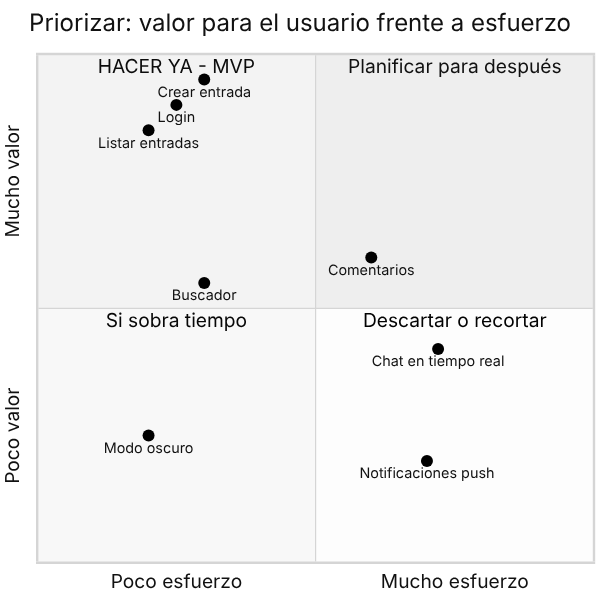{width=70%}

::: {.aviso custom-style="Aviso"}
**Aviso.** Los *W* (won't) son tan importantes como los *M*. Escribirlos evita discusiones del tipo "¿y por qué no hicimos el chat?" a una semana de la entrega: **lo descartamos el día 1, por escrito**.
:::

## 1.4. Cómo recortar a tiempo

Todos los proyectos se retrasan. Los buenos equipos **recortan pronto y a propósito**; los malos recortan tarde y a la desesperada. Reglas prácticas:

1. **Regla del 60 %.** Planifica solo el 60 % de tu tiempo disponible con tareas del backlog; el resto es para imprevistos, errores y pulido.
2. **El MVP primero, siempre.** No empieces ningún *Should* hasta que todos los *Must* funcionen *de principio a fin* (aunque sea feos).
3. **Semáforo semanal.** Cada viernes, 10 minutos: 🟢 vamos bien / 🟡 riesgo de retraso / 🔴 no llegamos. En 🟡, recortáis ya algo de *Should*; en 🔴, recortáis también *Must* simplificando (p. ej. "login con email" en vez de "login con Google").
4. **Recortar es simplificar, no quitar.** Si no llegas a "roles y permisos completos", quédate con "alumno y profesor" y deja "administrador" para la memoria como *trabajo futuro*.
5. **Una cosa terminada vale más que tres a medias.** Un tribunal ve lo que funciona en la demo.

::: {.empresa custom-style="En la empresa"}
**En la empresa.** Esto mismo se llama *gestión del alcance* (*scope management*). Verás expresiones como *scope creep* (el alcance que crece sin control), *roadmap* (hoja de ruta) y *backlog refinement* (revisar y priorizar el backlog). Cuando un cliente pide "una cosita más", un buen equipo pregunta: *"¿y qué quitamos para que quepa?"*
:::

## 1.5. La plantilla de anteproyecto

El **anteproyecto** es un documento corto (2–4 páginas) que escribís **antes de programar**. Sirve para ponerse de acuerdo entre vosotros dos y para que el profesorado pueda orientaros. Copia esta plantilla (también está en `curso-pim/plantillas/anteproyecto.md`):

```markdown
# Anteproyecto: <Nombre del proyecto>
Autores: <Nombre 1>, <Nombre 2> · Tutor/a: <nombre> · Fecha: <dd/mm/aaaa>

## 1. Resumen (máx. 20 palabras)
Es una <tipo de aplicación> para <usuarios> que les permite <acción> sin <problema>.

## 2. Problema y contexto
- Qué problema existe y a quién afecta.
- Cómo se resuelve hoy y por qué no basta.

## 3. Usuarios (personas)
| Rol | Qué quiere conseguir | Nivel técnico |
|---|---|---|

## 4. Requisitos
### 4.1 Funcionales (historias de usuario con prioridad MoSCoW)
| ID | Historia | Prioridad | Criterios de aceptación |
|---|---|---|---|
### 4.2 No funcionales (rendimiento, accesibilidad, seguridad, RGPD…)

## 5. Fuera de alcance (lo que NO haremos)
- …

## 6. Tecnologías previstas y justificación
| Capa | Elección | Por qué (y alternativa descartada) |
|---|---|---|

## 7. Planificación
Hitos y sprints (tabla o diagrama Gantt).

## 8. Riesgos
| Riesgo | Prob. | Impacto | Plan B / mitigación |
|---|---|---|---|

## 9. Reparto de responsabilidades y forma de trabajo
Quién lidera cada área, cómo revisamos el trabajo del otro, reuniones.
```

## 1.6. Riesgos: pensar en lo que puede salir mal

Un riesgo es algo que **puede** pasar y que, si pasa, daña el proyecto. Para cada uno estimas **probabilidad** (baja/media/alta) e **impacto** (bajo/medio/alto) y defines qué haréis. Es mucho más barato pensarlo hoy que descubrirlo en la última semana.

| Riesgo | Prob. | Impacto | Plan B |
|---|---|---|---|
| Una persona enferma o desaparece 2 semanas | Media | Alto | Ambos conocen todo el código (revisión cruzada); documentación al día. |
| Tecnología nueva más difícil de lo previsto | Alta | Medio | Prototipo ("spike") de 2 h en la semana 1; plan B con la tecnología conocida. |
| El despliegue falla el último día | Media | Alto | Desplegar una versión mínima en la semana 3 y re-desplegar en cada sprint. |
| Pérdida de código | Baja | Muy alto | Git con remoto en GitHub + ramas protegidas. |
| Discrepancias en la pareja | Media | Alto | Acuerdo de equipo (apartado 4) y revisión semanal. |

::: {.reto custom-style="Reto"}
**Reto 1 (60–90 min).** Con tu pareja: (1) escribid vuestro resumen de 20 palabras; (2) listad 10 funcionalidades y clasificadlas con MoSCoW; (3) dibujad la matriz valor/esfuerzo en una hoja; (4) completad las secciones 1–5 del anteproyecto. **Criterio de éxito:** vuestra lista *Must* cabe en 3–4 semanas de trabajo de dos personas.
:::

# 2. Metodología ágil a escala de dos personas

## 2.1. Qué es ágil y qué nos sirve

Las metodologías ágiles (Scrum, Kanban…) nacieron para equipos grandes. Con dos personas no necesitáis roles como *Scrum Master* ni reuniones de una hora. Pero **sí** os sirven sus ideas de fondo:

- **Trabajar en ciclos cortos** (1–2 semanas) y enseñar algo funcionando al final de cada uno.
- **Hacer visible el trabajo**: un tablero que cualquiera pueda mirar y saber "qué se está haciendo y qué falta".
- **Limitar el trabajo en curso**: terminar antes de empezar.
- **Mejorar continuamente**: una pequeña revisión al final de cada ciclo.

| | Scrum | Kanban | **Lo que usaremos (Scrumban)** |
|---|---|---|---|
| Ciclos | Sprints fijos | Flujo continuo | Sprints de 2 semanas |
| Planificación | Sprint planning | Bajo demanda | 30 min al inicio del sprint |
| Tablero | Sí | Sí (esencial) | Sí (Kanban en GitHub Projects) |
| Límite de trabajo en curso | Implícito | Explícito (WIP) | WIP = **2** por persona |
| Mejora | Retrospectiva | Opcional | 15 min al cierre |

## 2.2. El tablero Kanban en GitHub Projects

**GitHub Projects** es la herramienta de gestión de proyectos integrada en GitHub. Lo vas a encontrar (o su equivalente: Jira, Trello, Azure Boards, Linear, GitLab Boards) en la mayoría de empresas. Sus ventajas para vosotros: está **junto al código**, es gratuito y se conecta con issues y Pull Requests.

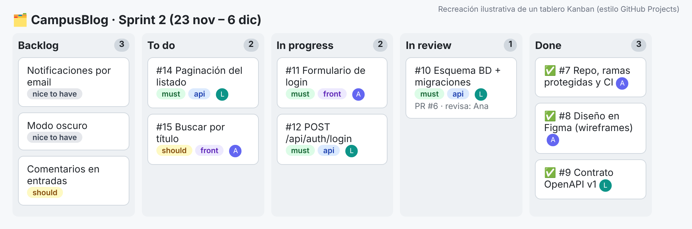{width=100%}

**Columnas recomendadas:** *Backlog → To do (este sprint) → In progress → In review → Done*.

**Reglas del tablero** (apuntadlas en el README):

1. Cada tarjeta es un **issue** con criterios de aceptación.
2. **WIP = 2**: nadie tiene más de 2 tarjetas en *In progress*. Si te quedas atascado, ayudas a tu pareja en vez de empezar otra.
3. Una tarjeta pasa a *In review* cuando abres la Pull Request, y a *Done* cuando se fusiona en `main`.
4. Las tarjetas llevan **etiquetas**: prioridad (`must`, `should`, `could`), área (`front`, `api`, `bd`, `docs`) y persona asignada.

GitHub Projects permite varias **vistas** del mismo conjunto de issues: *Board* (Kanban), *Table* (hoja de cálculo con campos propios como "Estimación" o "Sprint") y *Roadmap* (línea de tiempo). Además incluye **automatizaciones** (*workflows*): por ejemplo, mover una tarjeta a *Done* cuando se cierra el issue, o añadir automáticamente los issues nuevos al proyecto.

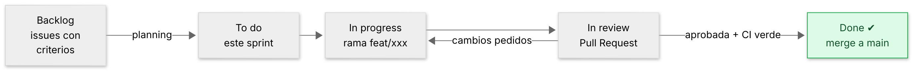{width=100%}

::: {.empresa custom-style="En la empresa"}
**En la empresa.** El tablero se conecta con el código: si en la descripción de la Pull Request escribes `Closes #14`, GitHub **cierra el issue #14 automáticamente** al fusionar. Así el tablero nunca miente. En Jira ocurre algo parecido incluyendo la clave del ticket (`CAMP-14`) en el nombre de la rama o del commit.
:::

## 2.3. Issues: una tarea bien escrita

Un issue vago ("hacer login") genera discusiones y retrasos. Uno bueno responde a *qué*, *por qué* y *cuándo está hecho*. Puedes dejar una plantilla en `.github/ISSUE_TEMPLATE/historia.md` para que aparezca al crear cada issue:

```markdown
---
name: Historia de usuario
about: Nueva funcionalidad
labels: ["must"]
---
## Historia
Como <rol>, quiero <acción> para <beneficio>.

## Criterios de aceptación
- [ ] Dado … cuando … entonces …
- [ ] Dado … cuando … entonces …

## Notas técnicas / enlaces
(diseño en Figma, endpoint de OpenAPI, dependencias…)

## Estimación
<1 / 2 / 3 / 5 puntos>  (tamaño relativo, no horas)
```

::: {.consejo custom-style="Consejo"}
**Consejo.** **Regla del día y medio:** si un issue parece que lleva más de 1–2 días, **trocéalo**. Las tarjetas pequeñas se terminan, se revisan en 10 minutos y dan sensación de avance. Las grandes se eternizan en *In progress*.
:::

## 2.4. Sprints cortos en dos personas

Un sprint de 2 semanas **no necesita más de 1 hora de reuniones en total**:

| Momento | Duración | Qué se hace |
|---|---|---|
| **Planning** (lunes, día 1) | 30 min | Elegís del backlog las tarjetas del sprint (máx. 60 % de la capacidad). Aseguráis que cada una tiene criterios de aceptación. |
| **Daily** (cada día) | 5–10 min (o mensaje) | Cada uno responde: ¿qué hice ayer? ¿qué haré hoy? ¿qué me bloquea? |
| **Review / demo** (último día) | 15 min | Os enseñáis (o enseñáis a vuestro tutor) lo que funciona. Solo cuenta lo *Done*. |
| **Retrospectiva** | 15 min | ¿Qué fue bien? ¿Qué mejoramos? Un solo cambio concreto para el siguiente sprint. |

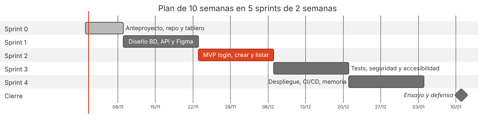{width=100%}

::: {.aviso custom-style="Aviso"}
**Aviso.** Fijad la **fecha de la demo del MVP** antes de empezar. Un MVP sin fecha es un "ya lo acabaremos". Y planificad un **despliegue temprano**: lo que no se despliega pronto, falla el último día.
:::

## 2.5. Definition of Done (y Definition of Ready)

La **Definition of Done (DoD)** es la lista de condiciones que *toda* tarjeta debe cumplir para considerarse terminada. Evita el eterno "ya casi está". Es un acuerdo entre vosotros dos, y es **la misma para todas las tarjetas**.

```markdown
## Definition of Done
- [ ] Cumple todos los criterios de aceptación del issue.
- [ ] Tiene tests (o una justificación de por qué no) y TODOS pasan.
- [ ] El linter y el formateador no dan avisos (npm run lint).
- [ ] Revisada y aprobada por la OTRA persona en una Pull Request.
- [ ] La documentación afectada está actualizada (README / OpenAPI / diagramas).
- [ ] Fusionada en main y el CI en verde.
- [ ] Se puede ver funcionando en el entorno de desarrollo/despliegue.
```

Su compañera es la **Definition of Ready (DoR)**: qué debe tener una tarjeta *antes* de entrar al sprint (historia clara, criterios de aceptación, tamaño razonable, sin dependencias bloqueantes).

::: {.reto custom-style="Reto"}
**Reto 2 (60 min).** Cread el repositorio y un **proyecto GitHub** con las 5 columnas. Pasad 8–10 historias de vuestro anteproyecto a issues con criterios de aceptación y etiquetas. Escribid vuestra DoD en el README. **Criterio de éxito:** cualquier persona ajena entiende, mirando solo el tablero, qué hacéis esta semana.
:::

# 3. Git en equipo

Git lo conoces de cursos anteriores. Aquí vamos a lo que cambia cuando **dos personas escriben a la vez en el mismo repositorio**: una estrategia de ramas, mensajes que se entienden, revisión de código y resolución de conflictos.

## 3.1. Elegir una estrategia de ramas

| Estrategia | Idea | Cuándo encaja |
|---|---|---|
| **Git Flow** | Ramas `develop`, `release`, `hotfix`… | Productos con versiones y lanzamientos programados. Demasiado pesado para vosotros. |
| **GitHub Flow** | `main` siempre desplegable + ramas cortas por tarea + PR. | **Recomendada para vuestro proyecto.** Simple y muy extendida. |
| **Trunk-based** | Todo el equipo integra en `main` varias veces al día con ramas de horas de vida (o directamente), apoyándose en CI y *feature flags*. | Equipos maduros con buena batería de tests. Es la evolución natural de GitHub Flow. |

**Reglas de GitHub Flow adaptadas a una pareja:**

1. `main` **siempre funciona** y es lo que se despliega.
2. Cada tarea = **una rama** nueva desde `main`, con nombre descriptivo: `feat/login`, `fix/paginacion`, `docs/readme`.
3. **Ramas cortas**: horas o 1–2 días como máximo. Cuanto más vive una rama, más duele fusionarla.
4. Se integra mediante **Pull Request**, revisada por la otra persona.
5. Tras fusionar, se **borra la rama**.

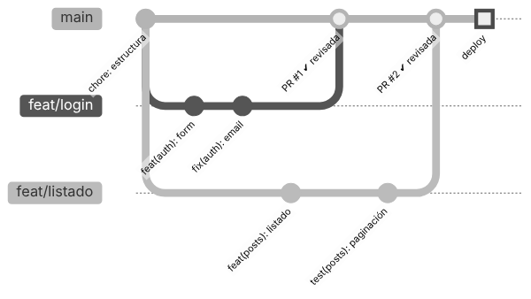{width=80%}

El **flujo diario** son solo estos comandos:

```bash
git switch main && git pull                # 1. partir de lo último
git switch -c feat/listado-entradas        # 2. rama nueva para la tarjeta
# ... trabajas, y vas guardando ...
git add -p                                 # 3. revisa qué incluyes
git commit -m "feat(posts): listado paginado de entradas"
git push -u origin feat/listado-entradas   # 4. subir la rama
# 5. Abrir Pull Request en GitHub → revisión → "Squash and merge"
git switch main && git pull && git branch -d feat/listado-entradas
```

## 3.2. Conventional Commits: mensajes que se entienden

Mira estos dos historiales. ¿Con cuál podrías preparar la memoria o entender qué ocurrió el martes?

```text
arreglo cosas            |  fix(posts): evitar duplicados en la paginación
más cambios              |  feat(auth): añadir formulario de login
asdf                     |  docs: documentar endpoint GET /api/posts
```

**Conventional Commits** es una convención (conocida y ampliamente usada) para escribir los mensajes con esta forma:

```text
<tipo>(<ámbito opcional>): <descripción en imperativo>

[cuerpo opcional: el porqué]

[pie opcional: BREAKING CHANGE, Closes #14]
```

| Tipo | Úsalo para | Ejemplo |
|---|---|---|
| `feat` | Una funcionalidad nueva | `feat(posts): buscar por título` |
| `fix` | Corregir un error | `fix(auth): rechazar emails sin dominio` |
| `docs` | Solo documentación | `docs: añadir diagrama ER al README` |
| `test` | Añadir o cambiar tests | `test(api): cubrir el 403 al borrar` |
| `refactor` | Cambiar el código sin cambiar el comportamiento | `refactor(db): extraer migraciones` |
| `style` | Formato (espacios, comas…) | `style: aplicar prettier` |
| `chore` | Tareas de mantenimiento, dependencias | `chore: actualizar express` |
| `ci` | Configuración de integración continua | `ci: ejecutar e2e en cada PR` |

Ventajas: el historial se lee como un **informe de trabajo**, se pueden **generar changelogs y versiones automáticamente** (herramientas como *semantic-release* o *release-please*), y puedes **filtrar** por tipo o por persona. Se puede **forzar** la convención con *commitlint* en un hook (lo veremos en el Tema 3).

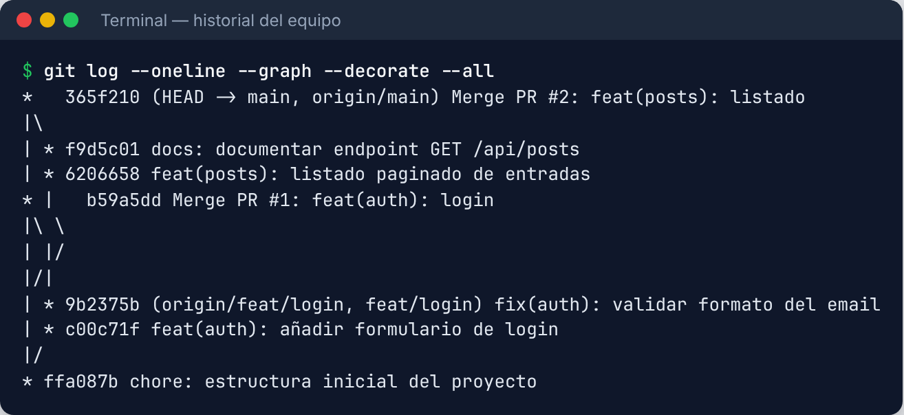{width=95%}

## 3.3. Pull Requests y revisión cruzada

Una **Pull Request (PR)** es una petición para integrar tu rama en `main`. Es el sitio donde **tu pareja revisa tu código antes de que entre**. Hace tres cosas a la vez:

1. **Control de calidad:** otra persona detecta errores y malos olores.
2. **Aprendizaje mutuo:** ambos conocéis TODO el código (clave para defenderlo).
3. **Evidencia:** queda por escrito quién propuso qué y cómo se discutió.

**Plantilla de PR** (`.github/pull_request_template.md`):

```markdown
## Qué hace esta PR
<!-- 1–3 frases -->

## Cómo probarlo
<!-- pasos para el revisor -->

## Checklist (Definition of Done)
- [ ] Criterios de aceptación cubiertos (Closes #__)
- [ ] Tests añadidos/actualizados y pasan
- [ ] Documentación actualizada
- [ ] Sin secretos ni datos personales en el código
```

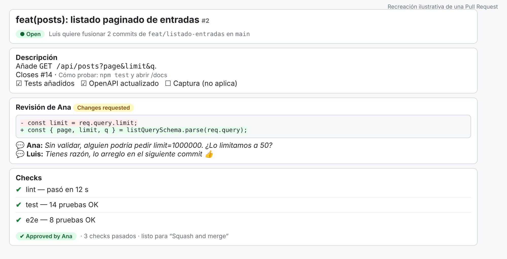{width=100%}

**Cómo revisar bien (guía para el revisor):**

1. Lee primero la descripción y el issue: ¿entiendes **qué** debería hacer?
2. Ejecuta la rama en tu máquina o mira el despliegue de la PR.
3. Revisa el *diff*: ¿es legible? ¿hay casos límite sin cubrir? ¿hay *datos del usuario sin validar*? ¿hay secretos?
4. Comenta con **respeto y precisión**: *"¿Qué pasa si `limit` es 1000000? Propongo limitarlo a 50"* mejor que *"esto está mal"*. Distingue lo **bloqueante** de las **sugerencias**.
5. Aprueba solo cuando **tú** serías capaz de explicar ese código.

::: {.aviso custom-style="Aviso"}
**Aviso.** El peor hábito de las parejas: *aprobar sin leer* ("LGTM" automático). Una revisión superficial os quita el beneficio de la revisión **y** la capacidad de defender el código ajeno ante el tribunal.
:::

## 3.4. Resolución de conflictos

Un **conflicto** aparece cuando Git no puede combinar automáticamente dos cambios en **las mismas líneas** de un mismo archivo. No es un error ni una catástrofe: es Git pidiéndoos que **decidáis** qué versión (o qué mezcla) es la correcta.

Para evitarlos: ramas cortas, `git pull` frecuente y **no tocar los mismos archivos a la vez** sin avisar (ni reformatear archivos enteros).

**Escenario real.** Ana cambió el título de la web a "CampusBlog - IES Ejemplo" y ya lo fusionó en `main`. Luis, en su rama, lo había cambiado a "Campus Blog 2026". Al traer `main` a su rama:

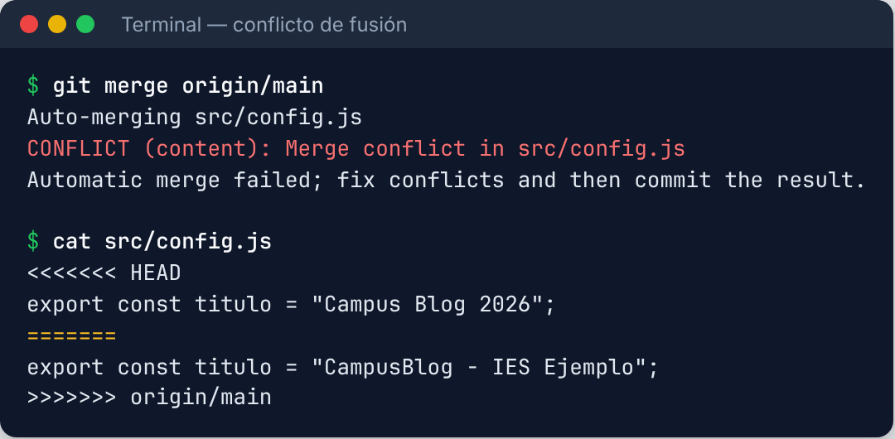{width=95%}

Entre `<<<<<<< HEAD` y `=======` está **tu versión**; entre `=======` y `>>>>>>> origin/main` está **la del otro**. Se resuelve en 4 pasos:

1. **Abrir** el archivo (VS Code lo muestra con botones *Accept Current / Incoming / Both* y un editor de fusión de 3 vías).
2. **Hablar** con tu pareja si no está claro cuál es la correcta (¡un conflicto es una conversación!).
3. **Dejar el resultado final** y **borrar los marcadores** `<<<<<<<`, `=======`, `>>>>>>>`.
4. `git add archivo` + `git commit` (o `git merge --continue`), y **volver a pasar los tests**.

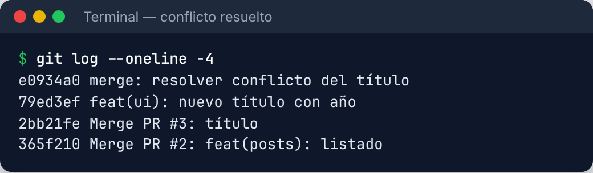{width=80%}

::: {.consejo custom-style="Consejo"}
**Consejo.** Si te lías, **`git merge --abort`** te devuelve al estado anterior sin consecuencias. Y recuerda: casi nada en Git se pierde del todo; `git reflog` lista todo lo que has hecho y permite recuperarlo.
:::

**Cuándo usar cada deshacer** (tabla de supervivencia):

| Situación | Comando |
|---|---|
| Me equivoqué en el último mensaje (aún sin subir) | `git commit --amend` |
| Quiero deshacer un commit **ya publicado** | `git revert <hash>` (crea un commit inverso; seguro) |
| Quiero descartar cambios sin commitear en un archivo | `git restore archivo` |
| Quiero guardar mi trabajo a medias para cambiar de rama | `git stash` / `git stash pop` |
| Perdí un commit | `git reflog` → `git switch -c rescate <hash>` |
| **Nunca** (en `main` compartida) | `git push --force` |

## 3.5. Proteger la rama main

Podéis ponerlo por norma ("no hacemos push a main"), pero es mucho mejor que **GitHub lo imponga**. En *Settings → Branches* (o *Rulesets*, la versión más moderna) configurad una regla sobre `main`:

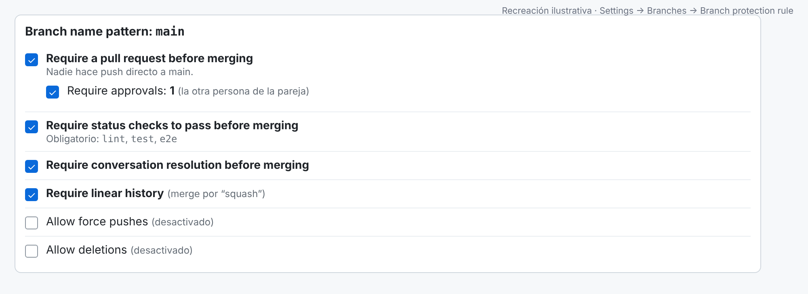{width=95%}

- **Requerir Pull Request** antes de fusionar, con **1 aprobación** (la de vuestra pareja).
- **Requerir que pasen los checks** del CI (lint, tests…).
- **Requerir resolver los comentarios** de la revisión.
- **Prohibir el *force push*** y el borrado de la rama.

Un **CI mínimo** (*Integración Continua*) con **GitHub Actions** ejecuta lint y tests en cada PR. Es un archivo en el propio repositorio, `.github/workflows/ci.yml`:

```yaml
name: CI
on:
  pull_request:
  push:
    branches: [main]
jobs:
  test:
    runs-on: ubuntu-latest
    steps:
      - uses: actions/checkout@v4
      - uses: actions/setup-node@v4
        with: { node-version: 22, cache: npm }
      - run: npm ci
      - run: npm run lint
      - run: npm test
```

Con esto, **una PR con tests rotos no se puede fusionar**. Es la red de seguridad más barata que existe. (En el Tema 3 la ampliamos con los tests E2E.)

::: {.empresa custom-style="En la empresa"}
**En la empresa.** Este mismo flujo (rama → PR → revisión → CI → merge) es el estándar de facto en prácticamente toda la industria. Cambian las herramientas: **GitHub Actions**, **GitLab CI/CD**, **Jenkins**, **Azure DevOps Pipelines**, **CircleCI**. Si aprendes bien una, aprendes todas. El archivo **CODEOWNERS** permite exigir que ciertas carpetas las revise una persona concreta.
:::

::: {.reto custom-style="Reto"}
**Reto 3 (90 min).** (1) Configurad las reglas de `main`. (2) Cada uno crea una rama distinta que modifique **la misma línea** del README, abre su PR y fusionad una; (3) resolved el **conflicto** de la otra con vuestra pareja. (4) Añadid el CI mínimo. **Criterio de éxito:** una PR con un test roto aparece bloqueada para fusionar.
:::

# 4. Reparto de trabajo y evidencias

## 4.1. El principio rector: "puedes defenderlo TODO"

En la defensa del proyecto, el tribunal puede preguntar a **cualquiera de los dos** sobre **cualquier parte**: "¿cómo funciona el login?", "¿por qué esa consulta SQL?". Tu nota individual depende de poder responder. Por eso **el reparto no puede ser "tú front, yo back"** con compartimentos estancos.

| Reparto | Ventaja | Problema |
|---|---|---|
| ❌ **Por capas** (uno front, otro back) | Parece eficiente. | Cada uno ignora la mitad; los problemas de integración aparecen tarde; imposible defender lo del otro. |
| ✅ **Por funcionalidades (*vertical slices*)** | Cada persona construye una historia **de la base de datos a la pantalla**. | Requiere coordinarse en el contrato de la API. |
| ✅ **Dueño + revisor** | Cada tarjeta tiene un *dueño* y un *revisor* (siempre el otro). | Exige disciplina de revisión. |

**Propuesta:** el *dueño* de una funcionalidad la construye completa; la otra persona la **revisa en la PR y la prueba**. Al final, cada uno ha **escrito** la mitad y **leído a fondo** la otra mitad. Podéis, además, alternar quién trabaja en el front y quién en el back entre sprints para que ambos ganéis perfil *full-stack*.

## 4.2. Programar juntos (pair programming)

Para las partes difíciles (el diseño de la base de datos, la autenticación, un bug rebelde), trabajad **a la vez** en la misma pantalla:

- **Conductor (driver):** escribe el código.
- **Navegante (navigator):** piensa en voz alta, revisa, busca documentación.
- **Cambiad de rol cada 20–30 minutos.**

A distancia podéis usar *Live Share* de VS Code, *Codespaces* o compartir pantalla. Es la forma más rápida de que ambos entendáis lo mismo, y es la práctica base de la programación en equipo en muchas empresas (*pair* y *mob programming*).

## 4.3. Evidencias de la aportación individual

El profesorado necesita ver **quién hizo qué** sin depender solo de lo que digáis. Estas son las evidencias **objetivas** que ya generáis casi sin esfuerzo si seguís el flujo del apartado anterior:

| Evidencia | Dónde está | Qué demuestra |
|---|---|---|
| Historial de commits | `git log`, GitHub → *Insights* | Autoría y ritmo de trabajo. |
| Pull Requests y revisiones | GitHub → *Pull requests* | Calidad de la revisión, discusiones técnicas. |
| Issues cerrados | Tablero de proyecto | Responsabilidades y avance del sprint. |
| ADRs (decisiones) | `docs/adr/` | Razonamiento técnico, no solo código. |
| Demo y defensa | Presentación | Comprensión **real** de todo el sistema. |

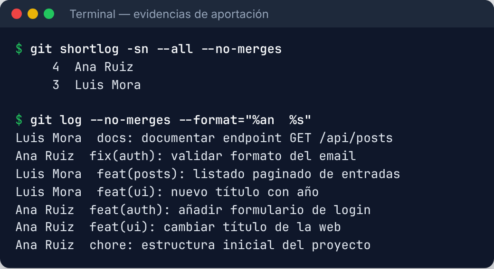{width=90%}

::: {.aviso custom-style="Aviso"}
**Aviso.** El número de commits **no** mide el esfuerzo: un commit enorme puede valer más que veinte triviales. Úsalo como *indicio* junto con las PRs, las revisiones y la defensa. Y, por favor, **cada uno commitea con su propia identidad** (`git config user.name` / `user.email`); trabajar con la cuenta del otro destruye las evidencias.
:::

### Registro de decisiones (ADR)

Un **ADR** (*Architecture Decision Record*) es una nota corta, de una página, que explica **una decisión importante**: qué se decidió, por qué y qué alternativas se descartaron. Dentro de tres meses (o en la defensa) agradeceréis recordar *por qué* elegisteis Express y no Laravel. Formato muy usado:

```markdown
# ADR-003: Elegimos SQLite en desarrollo y PostgreSQL en producción

- **Estado:** Aceptada · **Fecha:** 12/11/2026 · **Decide:** Ana y Luis

## Contexto
Necesitamos una BD relacional. Queremos arrancar sin instalar nada,
pero desplegar con una BD gestionada.

## Decisión
Usaremos SQLite (módulo node:sqlite) en local y PostgreSQL en producción,
con migraciones SQL versionadas en /migrations.

## Alternativas consideradas
- Solo PostgreSQL con Docker: más fiel a producción, pero exige Docker a todos.
- MongoDB: nuestros datos son muy relacionales (usuarios–entradas–categorías).

## Consecuencias
+ Arranque inmediato.  − Hay que evitar sintaxis específica de un motor.
```

### Acuerdo de equipo (team charter)

Redactad en 15 minutos un pequeño **acuerdo** y guardadlo en `docs/acuerdo-equipo.md`:

```markdown
- Horario de trabajo conjunto: martes y jueves 16:00–18:00 (presencial/online).
- Respuesta a mensajes: antes de 24 h en días lectivos.
- Revisión de PR: en menos de 24 h; nunca se aprueba sin leer.
- Si alguien no llega a su tarjeta: lo avisa 48 h antes y se renegocia el sprint.
- Cada uno trabaja con su propia cuenta de GitHub.
- Si hay un desacuerdo técnico: se escribe un ADR y se decide con prueba de concepto.
- Si el desacuerdo es personal o no se resuelve en una semana: se avisa al tutor.
```

## 4.4. Qué hacer si la pareja se desequilibra

Pasa más de lo que se admite: uno trabaja más, o uno sabe más. Recomendaciones:

1. **Hablad pronto** y con hechos del tablero ("llevamos 3 sprints con tu columna *To do* intacta"), no con reproches.
2. **Reducid el tamaño de las tarjetas** y haced *pair programming* para nivelar.
3. Que **el que sabe más revise más y explique** (enseñar es la mejor manera de aprender).
4. Si no se arregla en **una semana**, avisad al tutor *antes* de la crisis, con el acuerdo de equipo en la mano.

::: {.reto custom-style="Reto"}
**Reto 4 (45 min).** Escribid vuestro **acuerdo de equipo** y vuestro **primer ADR** (la elección de tecnologías). Haced cada uno al menos **un commit con su identidad real** y revisad la PR del otro con al menos **dos comentarios útiles**. **Criterio de éxito:** `git shortlog -sn` muestra a ambos.
:::

# 5. Documentación viva

La documentación que se escribe una vez y no se toca **miente** a los tres meses. La **documentación viva** (*docs as code*) vive en el repositorio, se versiona con el código, se revisa en las PR y se actualiza como parte de la *Definition of Done*.

## 5.1. Un README útil

El README es la **puerta de entrada**: lo primero que abre el profesorado, y lo primero que abrirá un reclutador cuando miren vuestro portfolio. Estructura recomendada:

1. **Nombre + una frase** (el resumen de 20 palabras) y una **captura o GIF**.
2. **Funcionalidades** (lista corta).
3. **Tecnologías** usadas.
4. **Cómo ejecutarlo** (copiar y pegar: ≤ 5 comandos). *Probadlo en un ordenador limpio.*
5. **Cómo lanzar los tests.**
6. **Documentación** (enlaces a `docs/`, API `/docs`, ADRs).
7. **Autores** y licencia.

```markdown
# 📝 CampusBlog
Blog colaborativo del centro: el alumnado escribe, el profesorado revisa, se publica.

## Arranque rápido
git clone https://github.com/<usuario>/campusblog.git && cd campusblog
cp .env.example .env     # y rellena los valores
npm ci && npm run dev:seed
# → http://localhost:3000   (API en /docs)
```

::: {.consejo custom-style="Consejo"}
**Consejo.** Pedid a alguien ajeno al proyecto que siga **solo** vuestro README. Donde se atasque, hay un hueco en la documentación.
:::

## 5.2. Diagramas como código con Mermaid

Dibujar diagramas con un programa gráfico tiene un problema: cada cambio exige abrirlo, editarlo y exportar la imagen, así que **se quedan desactualizados**. Con **Mermaid** (y **PlantUML**, similar) escribes el diagrama como **texto** dentro de un archivo `.md`; **GitHub lo dibuja automáticamente** en el README y lo puedes versionar y revisar en las PR como cualquier código.

Ejemplo: el **diagrama entidad-relación** de CampusBlog.

````markdown
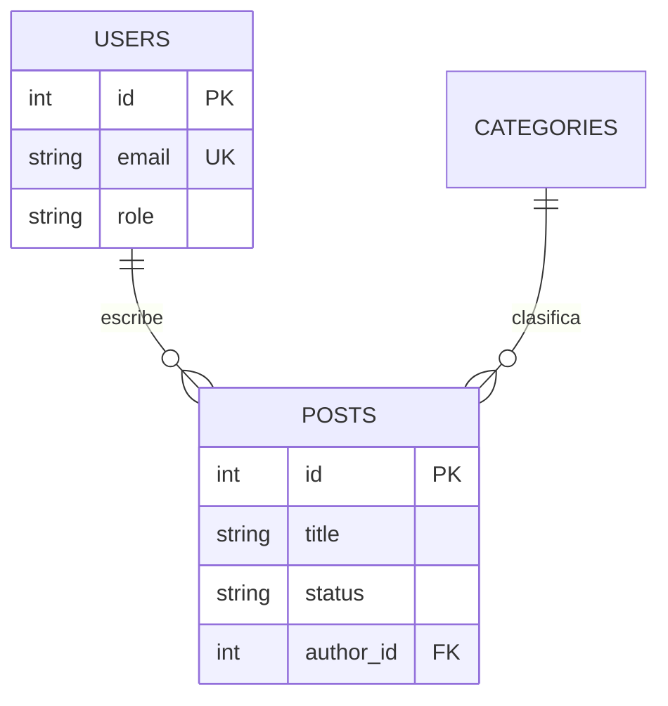
````

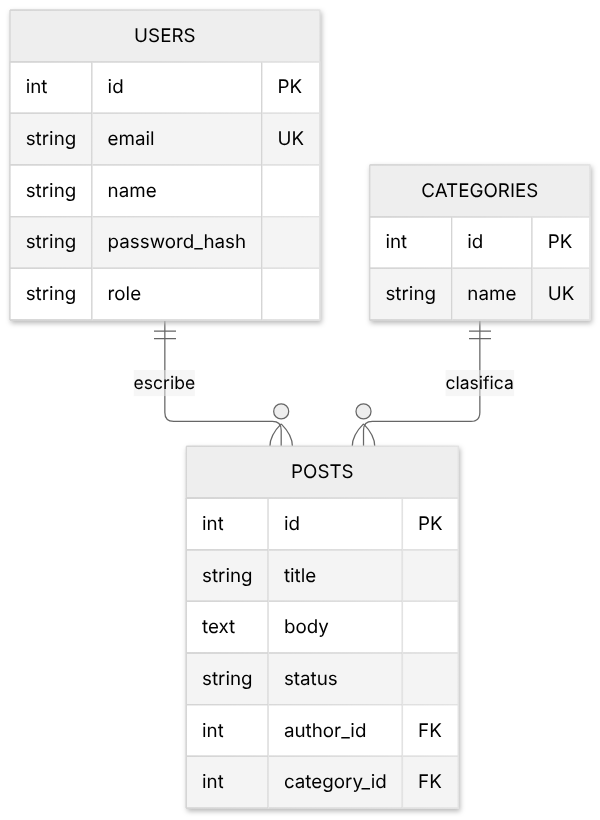{width=70%}

Ejemplo: el **diagrama de secuencia** del login (muy útil para explicar flujos entre front, API y base de datos).

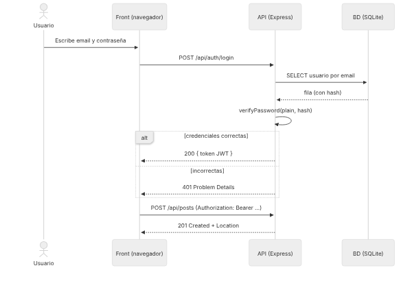{width=85%}

Mermaid admite también diagramas de flujo, de clases, de estados, Gantt, gráficos Git y más. En <https://mermaid.live> tienes un editor online con vista previa. PlantUML es la alternativa clásica y muy extendida en empresas con UML formal.

::: {.empresa custom-style="En la empresa"}
**En la empresa.** Verás *C4 model* (modelo de niveles para arquitectura), Mermaid/PlantUML en wikis (Confluence, GitLab, GitHub) y *Structurizr*. La idea de "el diagrama vive junto al código" es la misma.
:::

## 5.3. Documentar la API con OpenAPI y Swagger

Cuando front y back los construyen personas distintas, necesitáis un **contrato** que diga exactamente qué endpoints existen, qué reciben y qué devuelven. El estándar es **OpenAPI** (antes llamado Swagger): un archivo YAML o JSON que describe toda la API. De ese único archivo se **genera** documentación interactiva (**Swagger UI**), clientes, validaciones y hasta tests.

Fragmento del `openapi.yaml` de CampusBlog:

```yaml
paths:
  /api/posts:
    get:
      summary: Listar entradas publicadas (paginado)
      parameters:
        - { name: page,  in: query, schema: { type: integer, minimum: 1, default: 1 } }
        - { name: limit, in: query, schema: { type: integer, maximum: 50, default: 10 } }
      responses:
        '200':
          description: Página de entradas
          content:
            application/json:
              schema: { $ref: '#/components/schemas/PostPage' }
    post:
      summary: Crear una entrada (queda como borrador)
      security: [{ bearerAuth: [] }]
      responses:
        '201': { description: Creada }
        '401': { $ref: '#/components/responses/Problem' }
        '422': { $ref: '#/components/responses/Problem' }
```

Y así se ve **renderizada en Swagger UI** (servida por la propia API en `/docs`), con botón **Try it out** para probar los endpoints desde el navegador:

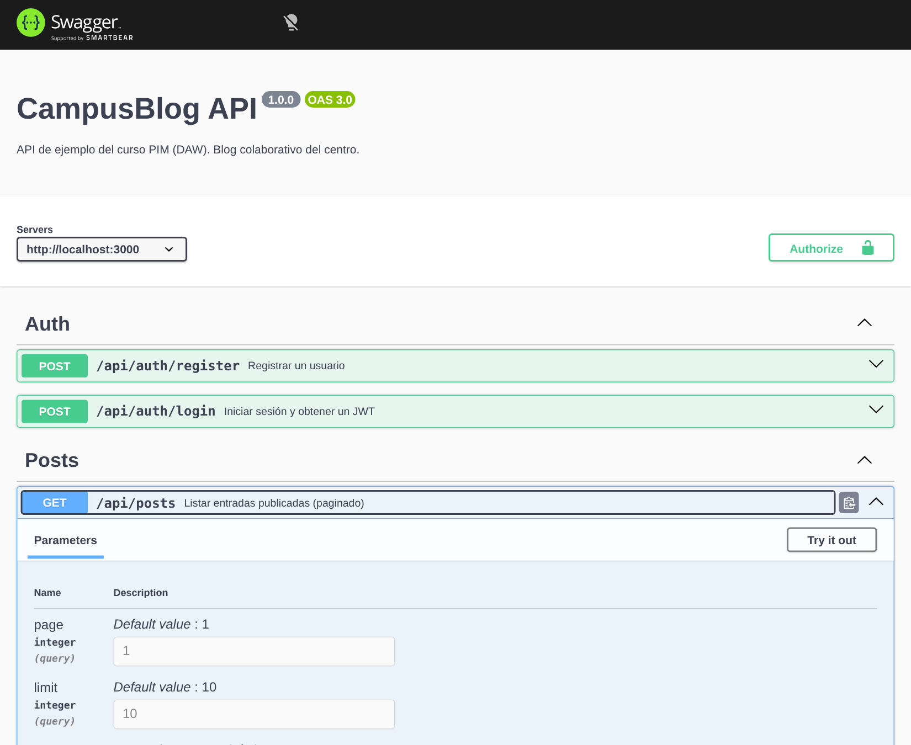{width=85%}

**Dos enfoques:**

- **Contract-first** (primero el contrato): escribís el OpenAPI **antes** de programar. Front y back trabajan en paralelo sobre el mismo contrato. Es lo que hacen los equipos profesionales y lo que os recomendamos.
- **Code-first**: la documentación se genera a partir del código (anotaciones en Spring Boot/*springdoc*, decoradores en NestJS, FastAPI lo genera solo). Más cómodo, pero el contrato aparece tarde.

Herramientas que verás en las empresas: **Swagger Editor / Swagger UI**, **Redoc** (documentación bonita), **Postman**, **Insomnia** y **Bruno** (clientes para probar APIs; pueden importar un OpenAPI), y generadores de clientes (*openapi-generator*).

## 5.4. Estructura de documentación recomendada

```text
campusblog/
├── README.md                 ← puerta de entrada
├── CHANGELOG.md              ← qué cambió en cada versión (puede ser automático)
├── openapi.yaml              ← contrato de la API
├── docs/
│   ├── anteproyecto.md
│   ├── acuerdo-equipo.md
│   ├── uso-ia.md             ← registro de uso de IA (Tema 4)
│   ├── adr/
│   │   ├── 0001-elegir-stack.md
│   │   └── 0002-autenticacion-jwt.md
│   └── diagramas/            ← .md con bloques mermaid
└── .github/
    ├── ISSUE_TEMPLATE/
    ├── pull_request_template.md
    └── workflows/ci.yml
```

::: {.reto custom-style="Reto"}
**Reto 5 (90 min).** (1) Escribid el **README** de vuestro proyecto con arranque en ≤ 5 comandos. (2) Dibujad con Mermaid el **diagrama ER** y un **diagrama de secuencia** del flujo más importante. (3) Redactad el `openapi.yaml` de **dos endpoints** y visualizadlos en <https://editor.swagger.io>. **Criterio de éxito:** una persona ajena puede arrancar el proyecto y entender cómo se hablan front y back.
:::

# Resumen del tema

- **Alcance:** define el problema, los usuarios y el **MVP** con MoSCoW; escribe lo que **NO** haréis; recorta pronto.
- **Anteproyecto:** problema, usuarios, requisitos, fuera de alcance, tecnologías, planificación y **riesgos** (con plan B).
- **Ágil a escala 2:** sprints de 2 semanas, tablero Kanban en **GitHub Projects**, **WIP = 2**, issues con criterios de aceptación y una **Definition of Done** común.
- **Git en equipo:** **GitHub Flow** (o trunk-based) con **ramas cortas**, **Conventional Commits**, **Pull Requests con revisión cruzada**, conflictos resueltos hablando, y `main` **protegida** con **CI**.
- **Reparto:** por funcionalidades (no por capas) con *dueño + revisor*; ambos debéis poder **defender todo**; evidencias = commits, PRs, issues, **ADRs** y defensa.
- **Documentación viva:** README ejecutable, **Mermaid** para diagramas, **OpenAPI/Swagger** como contrato de la API, todo versionado en el repositorio.

## Glosario

| Término | Significado |
|---|---|
| **MVP** | Producto mínimo viable: lo más pequeño que ya resuelve el problema principal. |
| **MoSCoW** | Must / Should / Could / Won't: método de priorización. |
| **Backlog** | Lista priorizada de todo lo pendiente. |
| **Sprint** | Ciclo de trabajo corto (1–2 semanas) con un objetivo. |
| **WIP** | *Work in progress*: trabajo en curso; se limita para terminar antes de empezar. |
| **DoD / DoR** | Definition of Done / Ready: criterios para dar algo por terminado / listo para empezar. |
| **GitHub Flow** | Estrategia de ramas simple: ramas cortas + Pull Request + `main` siempre desplegable. |
| **Trunk-based** | Integrar en `main` muy frecuentemente con ramas de vida muy corta. |
| **Pull Request** | Petición de fusión con revisión por otra persona. |
| **Conventional Commits** | Convención `tipo(ámbito): descripción` para mensajes de commit. |
| **CI** | Integración continua: ejecutar lint y tests automáticamente en cada cambio. |
| **ADR** | Registro breve de una decisión técnica y su justificación. |
| **OpenAPI** | Estándar para describir APIs REST; base de Swagger UI. |
| **Docs as code** | Documentación versionada con el código y revisada como código. |

## Recursos para seguir

- *GitHub Docs* — "GitHub Flow", "About Projects", "About protected branches" (docs.github.com).
- *Conventional Commits* — conventionalcommits.org (especificación en español disponible).
- *Pro Git* (libro gratuito, en español) — git-scm.com/book/es.
- *ADR* — adr.github.io.
- *Mermaid* — mermaid.js.org · *OpenAPI* — spec.openapis.org · *Swagger Editor* — editor.swagger.io.

# Autoevaluación

Contesta sin mirar los apartados. En el **paquete SCORM (Moodle)** las preguntas son interactivas y dan nota; aquí tienes las mismas con **solución razonada al final**. Aprobado: **70 %**.
