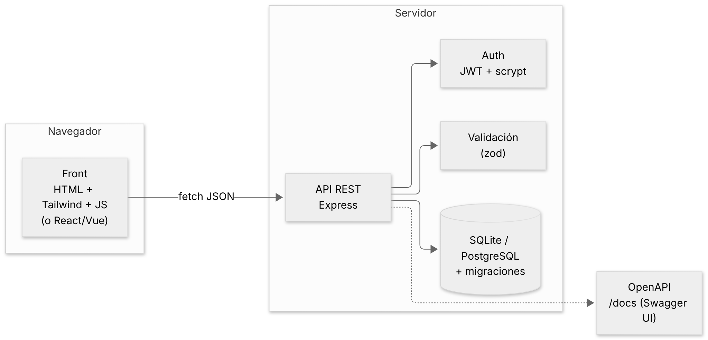
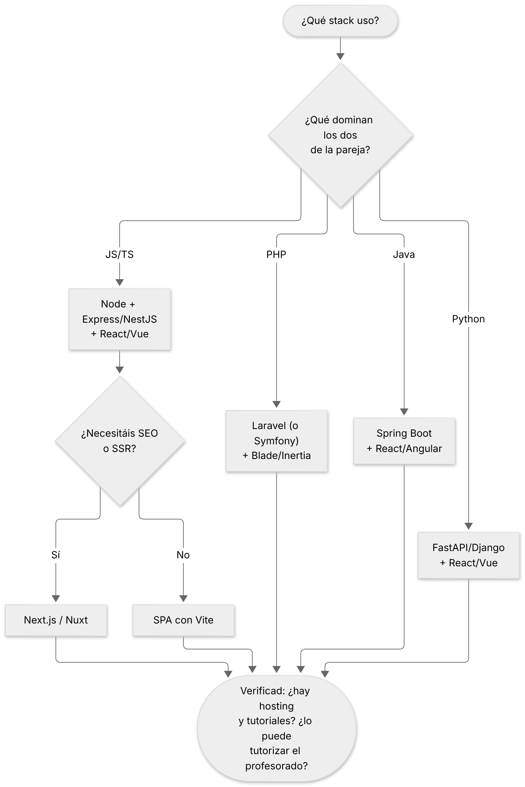
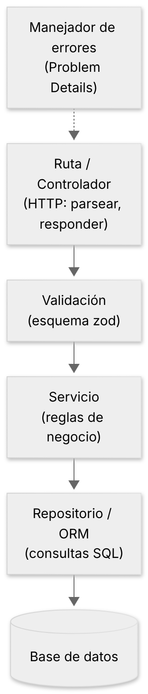
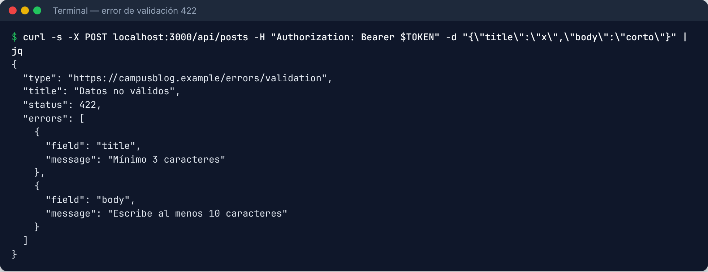
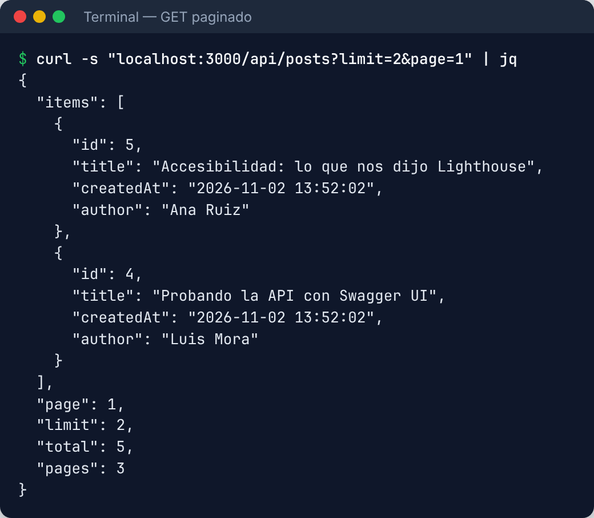
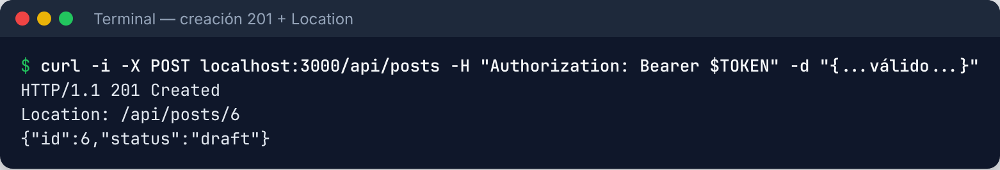
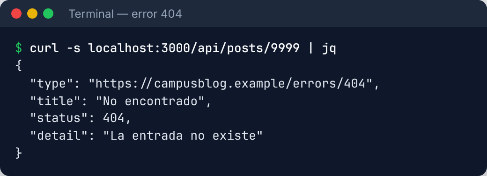
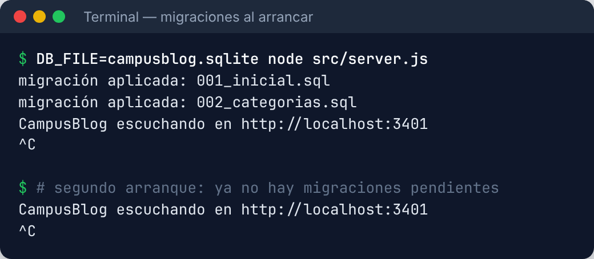
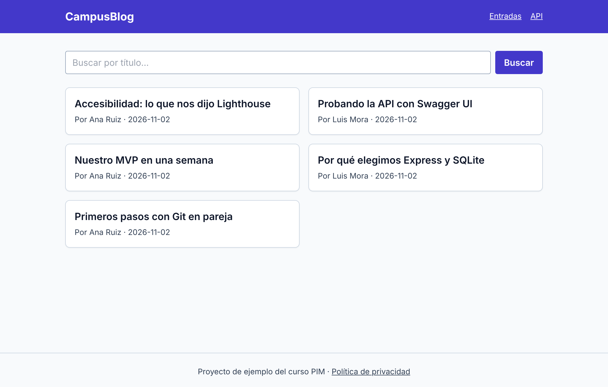
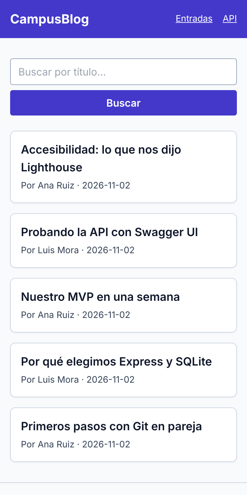

# Cómo usar este tema

Este tema te ayuda a **decidir con criterio** qué tecnologías usar en tu proyecto y a **usarlas bien**: una API REST bien diseñada, una base de datos con migraciones, un front moderno y una interfaz responsive y accesible. Está pensado para estudiarlo **de forma autónoma**.

**Tiempo estimado:** 10–12 horas (teoría + retos).

| Recuadro | Qué significa |
|---|---|
| 🟦 **Ejemplo** | Caso concreto de *CampusBlog*, el proyecto de referencia (Ana y Luis). |
| 🟩 **Consejo** | Un truco que te ahorra tiempo. |
| 🟥 **Aviso** | Un error típico que conviene evitar. |
| 🟧 **En la empresa** | Cómo se hace en una empresa real y qué herramienta verás en tus prácticas (FCT). |
| 🟪 **Reto** | Una tarea para aplicar lo aprendido en TU proyecto. |

## Objetivos de aprendizaje

Al terminar este tema serás capaz de:

1. **Elegir un stack** con una matriz de decisión razonada (y dejarlo escrito en un ADR).
2. Arrancar un proyecto con un **starter** oficial de la tecnología elegida.
3. Diseñar una **API REST**: recursos, verbos, códigos de estado, validación, paginación y errores homogéneos.
4. Modelar datos en **SQL** con **migraciones** y saber cuándo usar un **ORM** y cuándo **NoSQL**.
5. Elegir entre **React, Vue/Nuxt, Angular o Next.js** y justificar el uso de **TypeScript**.
6. Construir una interfaz **responsive desde el principio** con **Tailwind** y componentes accesibles (shadcn/ui, Bootstrap).

## Qué hay de verdad en CampusBlog

En el repositorio, `curso-pim/ejemplo-campusblog/` contiene una implementación **real y probada** de CampusBlog con: **Node 22 + Express**, **SQLite** con migraciones SQL, validación con **zod**, autenticación con **JWT**, documentación **OpenAPI**, front con **HTML + Tailwind CSS** y **14 tests** unitarios y de integración más **8 pruebas E2E**. Todo lo que aparece como "salida" en este tema (curl, capturas de la web, resultado de migraciones) está **ejecutado de verdad** sobre ese código.

::: {.aviso custom-style="Aviso"}
**Aviso de honestidad.** Para que todo el material fuese ejecutable y verificable, el *front* de la demo está hecho con JavaScript sencillo (sin *build*), mientras que en el texto te explico cómo se haría en **React, Vue, Next.js o Angular**. Los fragmentos de **NestJS, Laravel, Spring Boot, FastAPI y Prisma** son **código de referencia** que sigue la documentación oficial de cada herramienta; **no están ejecutados** en este curso, así que pruébalos siempre en tu proyecto antes de fiarte.
:::

# 1. Elegir el stack: criterios, no modas

Un **stack** es el conjunto de tecnologías de tu aplicación: lenguaje, *framework* de servidor, base de datos, *framework* de interfaz y herramientas. En los primeros días de un proyecto es tentador elegir "lo que está de moda" o "lo que quiero aprender". Es **la decisión con más riesgo** del proyecto: si te equivocas, pagas durante semanas.

{width=95%}

## 1.1. Criterios de decisión

| Criterio | Pregunta clave |
|---|---|
| **Dominio previo** | ¿Qué conocéis YA los dos? (el criterio más importante en un proyecto corto) |
| **Documentación y comunidad** | ¿Encontráis tutoriales, respuestas y ejemplos actuales? |
| **Empleabilidad** | ¿Se usa en empresas de vuestra zona? ¿Lo veréis en las prácticas? |
| **Despliegue** | ¿Hay hosting gratuito o barato y sencillo? |
| **Tutorización** | ¿Puede el profesorado ayudaros si os atascáis? |
| **Ecosistema** | ¿Hay librerías para autenticación, correo, pagos, tests…? |
| **Rendimiento** | Rara vez decide en un proyecto formativo, pero cuenta. |
| **Riesgo** | ¿Es una tecnología nueva para vosotros? Entonces haced un **spike**: un prototipo de 2–3 horas. |

## 1.2. La matriz de decisión ponderada

Es la herramienta más útil para decidir entre varias opciones **sin discutir a gritos**. Pasos:

1. Listad los **criterios** y dad a cada uno un **peso** (la suma de pesos = 100).
2. Puntuad cada opción de **1 a 5** en cada criterio (hablando con vuestra pareja).
3. Multiplicad puntuación × peso, sumad, y dividid entre 100.

**Ejemplo de Ana y Luis** (ambos dominan JavaScript; Luis algo de PHP):

| Criterio | Peso | A. Node + Express + React | B. Laravel + Blade | C. Spring Boot + React | D. FastAPI + Vue |
|---|---|---|---|---|---|
| Dominio previo de la pareja | 30 | 5 | 2 | 2 | 3 |
| Documentación y comunidad | 15 | 5 | 5 | 4 | 4 |
| Empleabilidad / uso en empresas | 15 | 5 | 4 | 5 | 3 |
| Facilidad de despliegue | 15 | 4 | 4 | 3 | 4 |
| Posibilidad de tutorización | 10 | 4 | 3 | 3 | 2 |
| Ecosistema de librerías | 10 | 5 | 5 | 5 | 4 |
| Rendimiento | 5 | 3 | 3 | 5 | 4 |
| **Resultado (sobre 5)** | **100** | **4,65** | **3,50** | **3,45** | **3,35** |

::: {.aviso custom-style="Aviso"}
**Aviso.** Estos números son de **Ana y Luis**, no tuyos. Si vuestra pareja domina PHP y Laravel, vuestra columna B ganará con toda justicia. Lo importante es el **método**, y que lo dejéis por escrito.
:::

## 1.3. Diagrama de decisión rápida

{width=90%}

## 1.4. Starters oficiales: no empieces desde cero

Cada tecnología tiene un **generador de proyectos** oficial que crea la estructura recomendada. Úsalos: ahorran horas y os dejan una base que otros profesionales reconocen.

| Tecnología | Cómo arrancar | Qué te da |
|---|---|---|
| **React** (SPA) | `npm create vite@latest mi-app -- --template react-ts` | Vite + React + TypeScript |
| **Next.js** (full-stack) | `npx create-next-app@latest` | React + enrutado + SSR + rutas API |
| **Vue** | `npm create vue@latest` | Vite + Vue + TypeScript opcional |
| **Nuxt** (full-stack Vue) | `npm create nuxt@latest` | Vue + SSR + rutas de servidor |
| **Angular** | `npx @angular/cli new mi-app` | Proyecto completo con CLI |
| **NestJS** | `npx @nestjs/cli new mi-api` | API en TypeScript con arquitectura modular |
| **Express** | `npm init -y && npm i express` | Mínimo y flexible (lo usa CampusBlog) |
| **Laravel** | `composer create-project laravel/laravel mi-app` | Framework PHP completo |
| **Spring Boot** | *Spring Initializr*: start.spring.io | Proyecto Java con las dependencias elegidas |
| **FastAPI** | `pip install "fastapi[standard]"` | API Python con docs OpenAPI automáticas |

::: {.empresa custom-style="En la empresa"}
**En la empresa.** El stack casi nunca lo eliges tú: lo hereda el equipo. Por eso es tan valioso el **criterio** y no solo la herramienta. Lo normal en 2026 (y por zona geográfica varía): **Java/Spring** y **.NET** en banca y grandes consultoras, **PHP/Laravel** en agencias y comercio electrónico, **Node/TypeScript + React** en producto y startups, **Python** en datos e IA. En tus prácticas verás **al menos una** de ellas.
:::

::: {.reto custom-style="Reto"}
**Reto 1 (60 min).** Rellenad vuestra **matriz de decisión** (3 stacks candidatos, 6–7 criterios con pesos) y escribid el **ADR** de la decisión (plantilla del Tema 1). Arrancad el **starter** ganador y subidlo al repositorio. **Criterio de éxito:** el proyecto arranca con un solo comando y el ADR está en `docs/adr/`.
:::

# 2. Backend: una API REST bien diseñada

Una **API REST** expone **recursos** (entradas, usuarios…) a través de URLs y los manipula con los **verbos HTTP**, devolviendo **JSON** y **códigos de estado** significativos. Una API "que funciona" es fácil; una API **bien diseñada** es la que no te da disgustos al integrar el front.

## 2.1. Recursos, URLs y verbos

Reglas de diseño que usa CampusBlog:

- **Sustantivos en plural**, no verbos: `/api/posts`, no `/api/getPosts`.
- El **verbo HTTP** expresa la acción.
- **Jerarquía** solo cuando hay pertenencia real: `/api/posts/7/comments`.
- Todo en **minúsculas**, con guiones si hace falta.

| Operación | Verbo y URL | Éxito | Notas |
|---|---|---|---|
| Listar | `GET /api/posts` | 200 | Paginado y filtrable |
| Ver una | `GET /api/posts/7` | 200 | 404 si no existe |
| Crear | `POST /api/posts` | **201** + cabecera `Location` | 401 sin sesión, 422 si es inválida |
| Reemplazar | `PUT /api/posts/7` | 200 / 204 | Envía el recurso completo |
| Modificar parte | `PATCH /api/posts/7` | 200 / 204 | Solo los campos que cambian |
| Borrar | `DELETE /api/posts/7` | **204** (sin cuerpo) | 403 si no eres el autor |
| Acción de negocio | `PATCH /api/posts/7/publish` | 204 | Cuando "publicar" no encaja en un CRUD |

## 2.2. Los códigos de estado que debes dominar

| Código | Significado | Cuándo |
|---|---|---|
| **200** OK | Todo bien | Lecturas y modificaciones con cuerpo |
| **201** Created | Recurso creado | Tras un `POST` correcto (con `Location`) |
| **204** No Content | Éxito sin cuerpo | `DELETE` y algunos `PATCH` |
| **400** Bad Request | Petición mal formada | JSON roto |
| **401** Unauthorized | **No estás autenticado** | Falta el token o ha caducado |
| **403** Forbidden | Autenticado, pero **sin permiso** | Alumno intentando publicar |
| **404** Not Found | No existe | ID inexistente |
| **409** Conflict | Choca con el estado actual | Email ya registrado |
| **422** Unprocessable Content | Datos con formato correcto pero **inválidos** | Título demasiado corto |
| **429** Too Many Requests | Límite de peticiones | Fuerza bruta en el login |
| **500** Internal Server Error | Fallo tuyo | Nunca debe ser por culpa del cliente |

::: {.aviso custom-style="Aviso"}
**Aviso.** El error más común: devolver **200 con `{ "error": "..." }`**. Rompe herramientas, cachés y el manejo de errores del front. Usa **el código de estado correcto**.
:::

## 2.3. Estructura por capas

Para que el código crezca sin convertirse en un lío, separa responsabilidades:

{width=60%}

- **Ruta/controlador:** recibe la petición HTTP y devuelve la respuesta. Nada de lógica de negocio.
- **Validación:** garantiza que los datos tienen el formato esperado **antes** de usarlos.
- **Servicio:** reglas de negocio ("solo el profesorado publica").
- **Repositorio/ORM:** consultas a la base de datos.
- **Manejador de errores único:** todos los errores salen con **el mismo formato**.

## 2.4. Validación de entrada

**Nunca te fíes de lo que llega del cliente**: ni del front (lo puede saltar cualquiera con `curl`) ni de un campo "ya validado en el formulario". La validación en el servidor es **obligatoria** (y es además una defensa de seguridad, Tema 3). En CampusBlog usamos **zod**, un validador muy extendido en el ecosistema TypeScript/JavaScript:

```javascript
import { z } from 'zod';

export const postSchema = z.object({
  title: z.string().trim().min(3, 'Mínimo 3 caracteres').max(120),
  body: z.string().trim().min(10, 'Escribe al menos 10 caracteres'),
  categoryId: z.number().int().positive().nullable().optional(),
});

// En la ruta: si no cumple, lanza un error que el manejador convierte en 422
const data = postSchema.parse(req.body);
```

Y así responde la API real cuando mandamos `{ "title": "x", "body": "corto" }`:

{width=85%}

## 2.5. Errores homogéneos (Problem Details)

Si cada endpoint devuelve los errores a su manera, el front tendrá que tratar cada caso por separado. Existe un estándar, **Problem Details for HTTP APIs (RFC 9457)**, con tipo de contenido `application/problem+json`:

```json
{
  "type": "https://campusblog.example/errors/validation",
  "title": "Datos no válidos",
  "status": 422,
  "errors": [{ "field": "title", "message": "Mínimo 3 caracteres" }]
}
```

Implementarlo es **un único middleware** (en CampusBlog, `src/errors.js`). Con eso, el front siempre sabe dónde mirar:

```javascript
export function errorHandler(err, _req, res, _next) {
  if (err.name === 'ZodError') {
    return res.status(422).type('application/problem+json').json({
      type: 'https://campusblog.example/errors/validation',
      title: 'Datos no válidos', status: 422,
      errors: err.issues.map((i) => ({ field: i.path.join('.'), message: i.message })),
    });
  }
  const status = err.status ?? 500;
  if (status >= 500) console.error(err);               // el detalle va al log...
  res.status(status).type('application/problem+json').json({
    type: `https://campusblog.example/errors/${status}`,
    title: status >= 500 ? 'Error interno' : err.title,  // ...no al cliente
    status,
  });
}
```

::: {.consejo custom-style="Consejo"}
**Consejo.** En los errores 5xx **nunca** devuelvas el mensaje interno, la traza ni la consulta SQL al cliente: son información para atacantes. Regístralo en el log y devuelve un mensaje genérico.
:::

## 2.6. Paginación, filtros y orden

Nunca devuelvas "todas las filas". Incluso con 50 entradas, tu API debe estar preparada para 50 000. Hay dos enfoques:

| | **Por desplazamiento** (`page` + `limit`) | **Por cursor** (`after=<id>`) |
|---|---|---|
| Sencillez | ✅ Muy simple | Algo más complejo |
| Páginas numeradas | ✅ Sí | ❌ No |
| Rendimiento con millones de filas | ❌ Se degrada | ✅ Estable |
| Cuándo | **Proyectos formativos**, listados con paginador | *Scroll* infinito, feeds muy grandes |

CampusBlog usa el primero: `GET /api/posts?page=2&limit=2`. Observa la **forma de la respuesta**: incluye los datos de paginación para que el front pinte el paginador sin calcular nada.

{width=75%}

Y observa el **límite máximo** (`limit` ≤ 50): si no lo pones, cualquiera pide `limit=1000000` y tumba tu servidor.

```javascript
export const listQuerySchema = z.object({
  page: z.coerce.number().int().min(1).default(1),
  limit: z.coerce.number().int().min(1).max(50).default(10),   // ← tope
  q: z.string().trim().max(100).optional(),                    // búsqueda por título
});
```

## 2.7. Crear recursos: 201 y la cabecera Location

Cuando creas algo, la buena práctica es responder **201** e indicar **dónde está** el nuevo recurso con la cabecera `Location`:

{width=80%}

Y cuando algo no existe, **404 con el mismo formato** de error:

{width=75%}

## 2.8. El mismo endpoint en cinco stacks

El endpoint `GET /api/posts` (listado paginado con validación) escrito en las tecnologías más habituales. **La idea es siempre la misma; cambia la sintaxis.** (Los cuatro últimos son código de referencia, **no ejecutado** en este curso.)

**Express (CampusBlog, ejecutado y testeado):**

```javascript
r.get('/', (req, res) => {
  const { page, limit, q } = listQuerySchema.parse(req.query);
  const like = `%${q ?? ''}%`;
  const total = db.prepare("SELECT COUNT(*) AS n FROM posts WHERE status='published' AND title LIKE ?").get(like).n;
  const items = db.prepare(`SELECT p.id, p.title, u.name AS author FROM posts p
      JOIN users u ON u.id = p.author_id
      WHERE p.status='published' AND p.title LIKE ?
      ORDER BY p.created_at DESC LIMIT ? OFFSET ?`).all(like, limit, (page - 1) * limit);
  res.json({ items, page, limit, total, pages: Math.ceil(total / limit) });
});
```

**NestJS (TypeScript, referencia):**

```typescript
@Controller('posts')
export class PostsController {
  constructor(private readonly posts: PostsService) {}

  @Get()
  list(@Query() q: ListPostsDto) {            // ListPostsDto valida con class-validator
    return this.posts.list(q);
  }
}
```

**Laravel (PHP, referencia):**

```php
Route::get('/posts', function (Request $request) {
    $data = $request->validate([
        'limit' => 'integer|min:1|max:50',
        'q'     => 'nullable|string|max:100',
    ]);
    return Post::where('status', 'published')
        ->when($data['q'] ?? null, fn ($query, $q) => $query->where('title', 'like', "%$q%"))
        ->latest()
        ->paginate($data['limit'] ?? 10);      // devuelve items + metadatos de paginación
});
```

**Spring Boot (Java, referencia):**

```java
@RestController
@RequestMapping("/api/posts")
@Validated
class PostController {
  private final PostRepository repo;
  PostController(PostRepository repo) { this.repo = repo; }

  @GetMapping
  Page<PostSummary> list(@RequestParam(defaultValue = "0") @Min(0) int page,
                         @RequestParam(defaultValue = "10") @Min(1) @Max(50) int size) {
    return repo.findByStatus(Status.PUBLISHED,
        PageRequest.of(page, size, Sort.by("createdAt").descending())).map(PostSummary::from);
  }
}
```

**FastAPI (Python, referencia):**

```python
@app.get("/api/posts")
def list_posts(page: int = Query(1, ge=1), limit: int = Query(10, ge=1, le=50),
               q: str | None = None, db: Session = Depends(get_db)):
    query = db.query(Post).filter(Post.status == "published")
    if q:
        query = query.filter(Post.title.ilike(f"%{q}%"))
    total = query.count()
    items = query.order_by(Post.created_at.desc()).offset((page - 1) * limit).limit(limit).all()
    return {"items": items, "page": page, "limit": limit, "total": total}
```

::: {.empresa custom-style="En la empresa"}
**En la empresa.** Fíjate en que **los cinco** validan la entrada, ponen un tope al tamaño de página, ordenan y devuelven metadatos. Cuando cambies de tecnología, no empieces de cero: traduce estos **conceptos**. Por cierto: **FastAPI** y **springdoc** generan la documentación OpenAPI *automáticamente* a partir del código (enfoque *code-first* del Tema 1).
:::

::: {.reto custom-style="Reto"}
**Reto 2 (2 h).** Implementad en vuestro stack **dos recursos** de vuestro proyecto con los cinco verbos. Comprobad con `curl` (o Bruno/Postman) que: los códigos de estado son correctos; la validación devuelve **422 con errores por campo**; el listado está **paginado con tope**; y los errores tienen **un único formato**. **Criterio de éxito:** podéis demostrar cada código de estado de la tabla 2.2 que aplique a vuestra API.
:::

# 3. Datos: SQL, migraciones, ORM y cuándo NoSQL

## 3.1. Relacional (SQL) por defecto

Para la inmensa mayoría de aplicaciones web (usuarios, pedidos, entradas, categorías…) los datos **están relacionados**, y una base de datos **relacional** (PostgreSQL, MySQL/MariaDB, SQL Server, SQLite) es la opción correcta:

- **Integridad:** claves foráneas, restricciones (`UNIQUE`, `CHECK`, `NOT NULL`).
- **Transacciones** (ACID): o se hace todo, o nada.
- **Consultas potentes:** `JOIN`, agregaciones, índices.
- **Lenguaje estándar** que reaprovechas toda la vida.

En CampusBlog, el esquema vive en **archivos SQL versionados** y se aplica con migraciones:

```sql
-- migrations/001_inicial.sql
CREATE TABLE users (
  id            INTEGER PRIMARY KEY AUTOINCREMENT,
  email         TEXT NOT NULL UNIQUE,
  name          TEXT NOT NULL,
  password_hash TEXT NOT NULL,
  role          TEXT NOT NULL DEFAULT 'student' CHECK (role IN ('student','teacher','admin'))
);
CREATE TABLE posts (
  id        INTEGER PRIMARY KEY AUTOINCREMENT,
  title     TEXT NOT NULL,
  body      TEXT NOT NULL,
  status    TEXT NOT NULL DEFAULT 'draft' CHECK (status IN ('draft','review','published')),
  author_id INTEGER NOT NULL REFERENCES users(id) ON DELETE CASCADE
);
CREATE INDEX idx_posts_status_created ON posts(status, created_at DESC);
```

Observa lo que **protege la base de datos por sí misma**: no puedes insertar un rol inventado, ni dos usuarios con el mismo email, ni una entrada con un autor que no existe. Esa es la **última línea de defensa** si falla la validación de la aplicación.

## 3.2. Migraciones: el control de versiones de tu base de datos

Cuando tu pareja cambia el esquema (añade una columna), **su base de datos local cambia, pero la tuya no**. Y en producción, tampoco. Las **migraciones** resuelven esto: cada cambio es un **archivo numerado** que se aplica **una sola vez**, en orden, en cualquier entorno.

```sql
-- migrations/002_categorias.sql  (el cambio de esquema, en su propio archivo)
CREATE TABLE categories (
  id   INTEGER PRIMARY KEY AUTOINCREMENT,
  name TEXT NOT NULL UNIQUE
);
ALTER TABLE posts ADD COLUMN category_id INTEGER REFERENCES categories(id);
```

CampusBlog las aplica al arrancar con un pequeño runner (`src/db.js`): guarda en una tabla `_migrations` cuáles se han ejecutado y aplica solo las pendientes, **dentro de una transacción** (si falla, se deshace).

```javascript
for (const f of readdirSync(dir).filter((f) => f.endsWith('.sql')).sort()) {
  if (done.has(f)) continue;               // ya aplicada: se salta
  db.exec('BEGIN');
  try {
    db.exec(readFileSync(path.join(dir, f), 'utf8'));
    db.prepare('INSERT INTO _migrations(name) VALUES (?)').run(f);
    db.exec('COMMIT');
  } catch (e) { db.exec('ROLLBACK'); throw e; }
}
```

{width=75%}

::: {.aviso custom-style="Aviso"}
**Aviso.** **Nunca edites una migración que ya se ha aplicado** (y menos si ya está en producción). Si te has equivocado, crea una **nueva** migración que lo corrija. Y **nunca modifiques la base de datos "a mano"** sin migración: tu pareja y el servidor se quedarán con un esquema distinto.
:::

::: {.empresa custom-style="En la empresa"}
**En la empresa.** Cada ecosistema trae su sistema: **Prisma Migrate** y **Drizzle Kit** (Node), **TypeORM/Knex**, **Laravel Migrations** (`php artisan migrate`), **Flyway** o **Liquibase** (Java), **Alembic** (Python/SQLAlchemy), **Entity Framework Migrations** (.NET). Todos hacen lo mismo que el runner de arriba, con más funciones (deshacer, generar a partir de modelos…).
:::

## 3.3. ¿ORM o SQL directo?

Un **ORM** (*Object-Relational Mapper*) te deja trabajar con **objetos** en vez de con SQL: `Post.findMany(...)`. A cambio, esconde lo que ocurre debajo.

| | **SQL directo / *query builder*** | **ORM** |
|---|---|---|
| Control y rendimiento | ✅ Total | Depende; suficiente casi siempre |
| Velocidad de desarrollo | Más código a mano | ✅ Menos código repetitivo |
| Tipado y autocompletado | Manual | ✅ Excelente (Prisma, Drizzle) |
| Curva de aprendizaje | SQL (que ya sabes) | SQL **+** el ORM |
| Riesgo | Concatenar strings → inyección SQL | Consultas ineficientes ocultas (N+1) |

Ejemplos de ORMs por stack: **Prisma / Drizzle / TypeORM** (Node), **Eloquent** (Laravel), **JPA/Hibernate + Spring Data** (Java), **SQLAlchemy / Django ORM** (Python), **Entity Framework** (.NET).

**Ejemplo con Prisma (referencia, no ejecutado):**

```prisma
// schema.prisma
model Post {
  id        Int      @id @default(autoincrement())
  title     String
  body      String
  status    String   @default("draft")
  author    User     @relation(fields: [authorId], references: [id])
  authorId  Int
  createdAt DateTime @default(now())
}
```

```bash
npx prisma migrate dev --name init     # genera y aplica la migración
```

```typescript
const posts = await prisma.post.findMany({
  where: { status: 'published' },
  orderBy: { createdAt: 'desc' },
  take: 10, skip: 0,
  include: { author: { select: { name: true } } },
});
```

### El problema N+1 (y por qué importa conocer SQL)

Es el error de rendimiento más famoso con ORMs: pides 10 entradas (1 consulta) y luego, **dentro de un bucle**, pides el autor de cada una (10 consultas más) → **11 consultas** en vez de 1 con `JOIN`.

```javascript
// ❌ N+1: una consulta por entrada
const posts = db.prepare('SELECT * FROM posts LIMIT 10').all();
for (const p of posts) p.author = db.prepare('SELECT name FROM users WHERE id = ?').get(p.author_id);

// ✅ Una sola consulta con JOIN (lo que hace CampusBlog)
db.prepare('SELECT p.id, p.title, u.name AS author FROM posts p JOIN users u ON u.id = p.author_id LIMIT 10').all();
```

::: {.consejo custom-style="Consejo"}
**Consejo.** Aunque uses ORM, **activa el registro de consultas SQL** en desarrollo y míralas de vez en cuando. Si ves 30 consultas para pintar una pantalla, hay un N+1.
:::

## 3.4. SQLite en desarrollo, PostgreSQL en producción

- **SQLite** es un archivo: no hay que instalar ni configurar nada. Perfecto para desarrollar y para proyectos pequeños (CampusBlog lo usa, incluso para los tests en memoria: `:memory:`).
- **PostgreSQL** es la opción robusta y más recomendada en producción hoy: es potente, gratuito y lo ofrecen casi todos los proveedores como servicio gestionado.

Para trabajar con PostgreSQL en local sin instalarlo, **Docker Compose** (lo verás más a fondo en el curso de despliegue):

```yaml
# docker-compose.yml
services:
  db:
    image: postgres:17
    environment:
      POSTGRES_USER: campus
      POSTGRES_PASSWORD: campus      # solo para desarrollo local
      POSTGRES_DB: campusblog
    ports: ["5432:5432"]
    volumes: [pgdata:/var/lib/postgresql/data]
volumes:
  pgdata: {}
```

```bash
docker compose up -d      # arranca la base de datos
```

::: {.aviso custom-style="Aviso"}
**Aviso.** SQLite y PostgreSQL **no son idénticos** (`AUTOINCREMENT` vs `GENERATED ... AS IDENTITY`, `datetime('now')` vs `now()`, tipos de fecha…). Si vais a desplegar en PostgreSQL, **probad con PostgreSQL** pronto (en la semana 3, no la última). Un ORM con migraciones generadas por motor os ahorra parte del problema.
:::

## 3.5. ¿Cuándo tiene sentido NoSQL?

"NoSQL" agrupa bases de datos de modelos muy distintos. No son "mejores que SQL": resuelven **otros problemas**.

| Tipo | Ejemplos | Úsala cuando… |
|---|---|---|
| **Documentos** | MongoDB, Firestore | Datos muy variables y anidados, esquema que cambia mucho, pocas relaciones. |
| **Clave–valor / caché** | Redis | Caché, sesiones, contadores, colas, límites de peticiones. |
| **Grafos** | Neo4j | Relaciones complejas (redes sociales, recomendaciones). |
| **Búsqueda** | Elasticsearch, Meilisearch | Búsqueda de texto avanzada. |

Ejemplo de un **documento** en MongoDB (todo anidado en un solo objeto):

```json
{
  "_id": "6540a1…",
  "title": "Primeros pasos con Git en pareja",
  "author": { "id": 1, "name": "Ana Ruiz" },
  "tags": ["git", "equipo"],
  "comments": [{ "user": "Luis", "text": "¡Buen resumen!" }]
}
```

**Regla práctica para tu proyecto:** empieza por **SQL**. Elige NoSQL solo si puedes explicar **por qué** tus datos no encajan en tablas (y por qué lo necesitas en un proyecto de unas semanas). Redis como *añadido* para caché o límites de peticiones es un buen motivo de "nueva tecnología" sin apostar toda la base de datos.

::: {.reto custom-style="Reto"}
**Reto 3 (90 min).** (1) Dibujad el **diagrama ER** de vuestro proyecto (Mermaid). (2) Escribid vuestras **dos primeras migraciones** y aplicadlas en una BD vacía. (3) Provocad un error: intentad insertar un dato que viole un `CHECK` o una clave foránea y anotad el mensaje. **Criterio de éxito:** otra persona clona el repositorio y obtiene el mismo esquema con un solo comando.
:::

# 4. Front: React, Vue/Nuxt, Angular o Next.js

## 4.1. Panorama

| Opción | Tipo | Aprendizaje | Mercado | Cuándo elegirla |
|---|---|---|---|---|
| **React** (+ Vite) | Librería de UI (SPA) | Medio | Muy alto | Máxima oferta laboral y ecosistema. |
| **Next.js** | *Framework* sobre React (full-stack, SSR) | Medio–alto | Muy alto | SEO, páginas rápidas, front y API en un solo proyecto. |
| **Vue** (+ Vite) | Framework progresivo (SPA) | Bajo–medio | Alto | Curva suave, excelente documentación. |
| **Nuxt** | Framework sobre Vue (full-stack, SSR) | Medio | Medio–alto | Lo mismo que Next, para el mundo Vue. |
| **Angular** | Framework completo con TypeScript | Alto | Alto (grandes empresas) | Equipos grandes y proyectos corporativos. |
| **JS "vanilla" + Tailwind** | Sin framework | Bajo | — | Proyectos muy pequeños o para entender los fundamentos (CampusBlog demo). |

**SPA, SSR y MPA en una línea:**

- **SPA** (*Single Page Application*): el navegador descarga la app y pinta todo con JavaScript. Ideal para paneles y apps "con sesión". Mal SEO por defecto.
- **SSR** (*Server-Side Rendering*): el servidor entrega el HTML ya pintado. Mejor **SEO** y primera carga. Lo dan Next.js y Nuxt.
- **MPA** (*Multi-Page App*): HTML generado por el servidor en cada página (Laravel Blade, Thymeleaf…). Sencillo y robusto.

::: {.consejo custom-style="Consejo"}
**Consejo.** Para un proyecto de unas semanas: **elegid lo que ya sepáis** y dedicad vuestra "dosis de novedad" a **una** sola cosa (por ejemplo, TypeScript, o Tailwind, o testing E2E). Cinco tecnologías nuevas a la vez es una receta para no terminar.
:::

## 4.2. TypeScript: por qué se recomienda

**TypeScript** es JavaScript con **tipos**. Se compila a JavaScript, pero te avisa de errores **mientras escribes**, no cuando el usuario los sufre.

```typescript
type Post = { id: number; title: string; author: string; createdAt: string };
type Page<T> = { items: T[]; page: number; pages: number; total: number };

async function loadPosts(page = 1): Promise<Page<Post>> {
  const res = await fetch(`/api/posts?page=${page}`);
  if (!res.ok) throw new Error(`HTTP ${res.status}`);
  return res.json();
}

const data = await loadPosts();
data.items[0].titulo;      // ❌ Error en el editor: la propiedad 'titulo' no existe. ¿Quisiste decir 'title'?
```

Ventajas: **autocompletado**, errores de nombres y tipos detectados al instante, **refactorizar** con confianza y un código que **se documenta solo**. Hoy es lo habitual en empresas con React, Angular, NestJS y Next.js (y cada vez más con Vue). Cuesta un par de días acostumbrarse y se amortiza el resto del proyecto.

## 4.3. El mismo listado en tres frameworks

Todos hacen lo mismo: **pedir** el listado a la API, **gestionar los estados** (cargando, error, datos) y **pintarlo**.

**React + Vite (referencia):**

```tsx
export function PostList() {
  const [data, setData] = useState<Page<Post> | null>(null);
  const [error, setError] = useState<string | null>(null);

  useEffect(() => {
    const ctrl = new AbortController();               // cancelar si el componente se desmonta
    fetch(`${import.meta.env.VITE_API_URL}/api/posts?limit=6`, { signal: ctrl.signal })
      .then((r) => { if (!r.ok) throw new Error(`HTTP ${r.status}`); return r.json() as Promise<Page<Post>>; })
      .then(setData)
      .catch((e) => e.name !== 'AbortError' && setError(e.message));
    return () => ctrl.abort();
  }, []);

  if (error) return <p role="alert">No se pudo cargar: {error}</p>;
  if (!data) return <p>Cargando…</p>;
  return <ul>{data.items.map((p) => <li key={p.id}>{p.title} · {p.author}</li>)}</ul>;
}
```

Con **TanStack Query** (muy usada en empresas) todo el control de estados, caché y reintentos se reduce a:

```tsx
const { data, isPending, error } = useQuery({
  queryKey: ['posts', page],
  queryFn: () => fetch(`/api/posts?page=${page}`).then((r) => r.json() as Promise<Page<Post>>),
});
```

**Vue 3 / Nuxt (referencia):**

```vue
<script setup lang="ts">
const { data, pending, error } = await useFetch<Page<Post>>('/api/posts', { query: { limit: 6 } });
</script>

<template>
  <p v-if="pending">Cargando…</p>
  <p v-else-if="error" role="alert">No se pudo cargar</p>
  <ul v-else><li v-for="p in data?.items" :key="p.id">{{ p.title }} · {{ p.author }}</li></ul>
</template>
```

**Next.js, App Router (referencia):** el componente se ejecuta **en el servidor** y puede pedir los datos directamente:

```tsx
export default async function Home() {
  const res = await fetch(`${process.env.API_URL}/api/posts?limit=6`, { next: { revalidate: 60 } });
  const data: Page<Post> = await res.json();
  return <ul>{data.items.map((p) => <li key={p.id}>{p.title} · {p.author}</li>)}</ul>;
}
```

**La demo de CampusBlog (JavaScript sin framework, ejecutada y testeada)** hace exactamente lo mismo con el DOM. Fíjate en un detalle de seguridad: usa `textContent`, **nunca** `innerHTML` con datos de usuarios (prevención de XSS, Tema 3):

```javascript
async function cargar(q = '') {
  const res = await fetch(`/api/posts?limit=6&q=${encodeURIComponent(q)}`);
  const { items } = await res.json();
  lista.replaceChildren(...items.map((p) => {
    const li = document.createElement('li');
    const h2 = document.createElement('h2');
    h2.textContent = p.title;               // textContent: el navegador NO interpreta HTML
    li.append(h2);
    return li;
  }));
}
```

::: {.empresa custom-style="En la empresa"}
**En la empresa.** El patrón "estado de **cargando / error / vacío / datos**" lo verás en **todas** las pantallas de cualquier app. Y fijaos en que el front **nunca** debe asumir que la API responde bien: gestionad el error (`!res.ok`) siempre. La variable de entorno de la URL de la API (`VITE_API_URL`) permite apuntar a desarrollo o a producción sin tocar el código.
:::

::: {.reto custom-style="Reto"}
**Reto 4 (2 h).** Haced la pantalla de **listado** de vuestro proyecto, con los **cuatro estados** (cargando, error, vacío, datos) y paginación. Probad el estado de error **apagando la API**. **Criterio de éxito:** la pantalla nunca queda en blanco ni muestra "undefined".
:::

# 5. UI: Tailwind, componentes accesibles y responsive desde el principio

## 5.1. Tailwind CSS: clases de utilidad

**Tailwind** es hoy el framework CSS más usado en proyectos nuevos. En vez de escribir CSS aparte, compones el diseño con **clases de utilidad** pequeñas directamente en el HTML (`p-4`, `text-lg`, `bg-indigo-700`, `rounded`…). Ventajas: no inventas nombres de clases, el diseño **no se mezcla** con otros estilos, y el CSS final solo contiene **lo que usas** (el de CampusBlog pesa **menos de 8 KB**, ya minificado).

```html
<button class="rounded bg-indigo-700 px-4 py-2 font-semibold text-white hover:bg-indigo-800"
        type="submit">Buscar</button>
```

Lo lees como una frase: *"redondeado, fondo índigo, padding horizontal 4 y vertical 2, negrita, texto blanco, al pasar el ratón fondo más oscuro"*. Para generarlo (Tailwind v3 con su CLI):

```bash
npm i -D tailwindcss@3
npx tailwindcss -i src-css/input.css -o public/styles.css --minify
```

::: {.empresa custom-style="En la empresa"}
**En la empresa.** Tailwind convive con **Bootstrap**, **Material UI (MUI)**, **Angular Material** y **sistemas de diseño propios**. Casi todos los proyectos serios tienen un **sistema de diseño**: colores, tipografías y espaciados definidos una vez (*design tokens*) y reutilizados. En Tailwind se configuran en `tailwind.config.js`; en Figma, como *variables*.
:::

## 5.2. Mobile-first y responsive

**Responsive** significa que la misma web se adapta a móvil, tableta y escritorio. En Tailwind se hace con **prefijos de punto de ruptura** y con un enfoque **mobile-first**: primero el diseño de móvil (sin prefijo) y luego se amplía.

```html
<ul class="grid gap-4 sm:grid-cols-2">…</ul>
<!-- móvil: 1 columna (por defecto) · desde 640 px (sm:): 2 columnas -->

<form class="flex flex-col gap-2 sm:flex-row">…</form>
<!-- móvil: campos apilados · desde sm: en fila -->
```

Así se ve **la misma página real de CampusBlog** en escritorio y en móvil (capturas reales con Chromium):

{width=85%}

{width=40%}

**Checklist responsive mínimo:**

- `<meta name="viewport" content="width=device-width, initial-scale=1">` en el `<head>` (sin él, el móvil "encoge" la web).
- Diseña **primero el móvil**, luego amplía.
- Nada de anchuras fijas en píxeles para contenedores (usa `max-w-*`, `w-full`, `grid`, `flex`).
- Zonas táctiles de **al menos 44×44 px**.
- Imágenes con `max-width: 100%` (en Tailwind: `max-w-full h-auto`).
- Prueba con las **herramientas de desarrollador** (modo dispositivo) **y** con un móvil real.

## 5.3. Componentes accesibles ya hechos

Construir a mano un *modal*, un menú desplegable o un *tabs* **accesible** (teclado, lector de pantalla, gestión del foco) es sorprendentemente difícil. No lo hagas: usa componentes que ya lo resuelven.

| Opción | Qué es | Notas |
|---|---|---|
| **shadcn/ui** | Colección de componentes (botones, diálogos, tablas…) para **React + Tailwind**, que **copias a tu proyecto** | Basada en **Radix UI** (primitivas accesibles). Muy popular hoy. El código es tuyo y lo puedes modificar. |
| **Radix UI / Headless UI** | Componentes **sin estilo** con accesibilidad resuelta | Los estilas tú con Tailwind. |
| **Bootstrap 5** | Framework CSS + componentes (JS opcional) | Muy conocido, ideal si ya lo dominas; menos "moderno" visualmente. |
| **Material UI / Angular Material / Vuetify** | Componentes según Material Design | Habituales en entornos corporativos (React, Angular, Vue). |
| **daisyUI** | Componentes prediseñados sobre clases de Tailwind | Rápido para prototipar. |

Ejemplo de uso de **shadcn/ui** (React, referencia): se añade un componente con la CLI y se importa como cualquier otro.

```bash
npx shadcn@latest init
npx shadcn@latest add button dialog
```

```tsx
import { Button } from "@/components/ui/button";
<Button variant="outline" onClick={guardar}>Guardar</Button>
```

::: {.consejo custom-style="Consejo"}
**Consejo.** En la demo de CampusBlog hay tres detalles de accesibilidad **que cuestan cero**: un enlace "Saltar al contenido" (`sr-only focus:not-sr-only`), una etiqueta `<label>` oculta visualmente (`sr-only`) para el campo de búsqueda, y `aria-live="polite"` en la lista para que los lectores de pantalla anuncien los cambios. En el Tema 3 medimos esto con herramientas automáticas.
:::

## 5.4. De Figma al código

No empecéis a programar pantallas "a ojo". Dedicad 2–3 horas a **wireframes en Figma** (la herramienta estándar de diseño de interfaces): estructura de cada pantalla, flujos y componentes repetidos. Sacad de ahí vuestros **tokens** (2–3 colores, 2 tipografías, escala de espaciado) y vuestra lista de **componentes** (botón, tarjeta, formulario…). Es mucho más barato rediseñar un rectángulo en Figma que reescribir un componente.

::: {.reto custom-style="Reto"}
**Reto 5 (2 h).** (1) Diseñad en Figma (o papel) **3 pantallas** de vuestro proyecto en móvil. (2) Implementad una con Tailwind (o vuestro framework CSS) **mobile-first**. (3) Comprobad que **se usa solo con teclado** (Tab / Enter / Esc) y que se ve bien a 360 px y a 1280 px. **Criterio de éxito:** sin scroll horizontal a 360 px y todos los controles alcanzables con el teclado.
:::

# Resumen del tema

- **Elegir stack** con una **matriz ponderada** (el dominio previo pesa más); decisión por escrito en un **ADR**; arrancar con el **starter** oficial.
- **API REST:** recursos en plural, verbos HTTP, **códigos de estado correctos** (201+`Location`, 204, 401≠403, 422), **validación en servidor**, **paginación con tope** y **errores homogéneos** (Problem Details).
- **Capas:** ruta → validación → servicio → datos, y un único manejador de errores.
- **SQL por defecto**, con restricciones en la base de datos y **migraciones** versionadas (nunca editar las aplicadas). **ORM** para productividad, vigilando el **N+1**. **NoSQL** solo con un motivo claro (Redis como añadido es un buen comienzo).
- **Front:** React/Next, Vue/Nuxt o Angular según dominio; **TypeScript** recomendado; siempre gestionar **cargando / error / vacío / datos**.
- **UI:** **Tailwind** mobile-first, componentes accesibles ya hechos (**shadcn/ui**, Bootstrap, Radix), prototipo en **Figma**.

## Glosario

| Término | Significado |
|---|---|
| **Stack** | Conjunto de tecnologías de una aplicación. |
| **Spike** | Prototipo corto para reducir el riesgo de una tecnología nueva. |
| **REST** | Estilo de API basado en recursos, verbos HTTP y códigos de estado. |
| **Problem Details** | Formato estándar (RFC 9457) para errores de API. |
| **Paginación** | Devolver los datos por páginas en vez de todos de golpe. |
| **Migración** | Archivo versionado que cambia el esquema de la BD de forma reproducible. |
| **ORM** | Capa que mapea tablas a objetos (Prisma, Eloquent, JPA…). |
| **N+1** | Anti-patrón: 1 consulta + N consultas dentro de un bucle. |
| **SPA / SSR / MPA** | App de una página / renderizado en servidor / app de varias páginas. |
| **TypeScript** | JavaScript con tipos estáticos. |
| **Utility-first** | CSS con clases pequeñas de utilidad (Tailwind). |
| **Mobile-first** | Diseñar primero para móvil y ampliar a pantallas mayores. |
| **Design tokens** | Valores de diseño (color, tipografía, espaciado) definidos una vez. |

## Recursos para seguir

- *MDN Web Docs* — "HTTP response status codes" y "Learn web development" (developer.mozilla.org).
- *RFC 9457* — Problem Details for HTTP APIs (rfc-editor.org).
- Documentación oficial: react.dev · vuejs.org · nextjs.org · angular.dev · nestjs.com · laravel.com · spring.io · fastapi.tiangolo.com.
- *Tailwind CSS* — tailwindcss.com · *shadcn/ui* — ui.shadcn.com · *Radix UI* — radix-ui.com.
- *Prisma* — prisma.io · *PostgreSQL* — postgresql.org/docs · *Use The Index, Luke* — use-the-index-luke.com (índices SQL).

# Autoevaluación

Contesta sin mirar los apartados. En el **paquete SCORM (Moodle)** las preguntas son interactivas y dan nota; aquí tienes las mismas con **solución razonada al final**. Aprobado: **70 %**.
