# Cómo usar este tema

Un proyecto que "funciona en mi ordenador" no es un proyecto terminado. En este tema aprenderás las prácticas que separan un trabajo de clase de un **producto de calidad profesional**: **pruebas automáticas, seguridad, accesibilidad, protección de datos y herramientas que vigilan tu código por ti**. Está pensado para estudiarlo **de forma autónoma**.

**Tiempo estimado:** 12–14 horas (teoría + retos).

| Recuadro | Qué significa |
|---|---|
| 🟦 **Ejemplo** | Caso concreto de *CampusBlog*, el proyecto de referencia (Ana y Luis). |
| 🟩 **Consejo** | Un truco que te ahorra tiempo. |
| 🟥 **Aviso** | Un error típico que conviene evitar. |
| 🟧 **En la empresa** | Cómo se hace en una empresa real y qué herramienta verás en tus prácticas (FCT). |
| 🟪 **Reto** | Una tarea para aplicar lo aprendido en TU proyecto. |

## Objetivos de aprendizaje

Al terminar este tema serás capaz de:

1. Escribir **tests unitarios, de integración y E2E (Playwright)** y decidir **qué merece la pena probar**.
2. Aplicar las defensas básicas del **OWASP Top 10**: autenticación, *hash* de contraseñas, CORS, validación, inyección SQL, XSS, CSRF y gestión de secretos.
3. Medir y mejorar la **accesibilidad (WCAG)** y el **rendimiento (Core Web Vitals)** con **axe** y **Lighthouse**.
4. Aplicar el **RGPD y la LOPDGDD** a tu proyecto: política de privacidad, cookies y minimización de datos.
5. Automatizar la calidad con **ESLint, Prettier y *pre-commit hooks***.

## Todo lo que ves aquí está ejecutado de verdad

En `curso-pim/ejemplo-campusblog/` está el código completo de CampusBlog. Las **salidas de terminal, informes de Lighthouse, de Playwright y de axe** de este tema son **resultados reales** de ejecutar esos programas. Cuando una captura es una *recreación ilustrativa* (porque depende de un servicio externo), se indica.

::: {.aviso custom-style="Aviso"}
**Aviso.** Este tema enseña **defensa**. La demostración de inyección SQL (apartado 2.5) es **didáctica, sobre una base de datos de juguete en memoria**. Atacar sistemas ajenos sin autorización es **delito**. Practica solo en tus propios proyectos o en entornos creados para ello.
:::

# 1. Calidad: tests automáticos

## 1.1. Por qué probar

Cada vez que cambias algo, **puedes romper algo que ya funcionaba** (sin darte cuenta). Probar a mano todo cada vez es lento, aburrido y se acaba no haciendo. Los **tests automáticos** son una red de seguridad: los ejecutas en segundos y te dicen *"todo sigue funcionando"* o *"has roto esto"*. Son además lo que te permite **refactorizar sin miedo** y la base de la **integración continua** (Tema 1).

## 1.2. La pirámide de tests

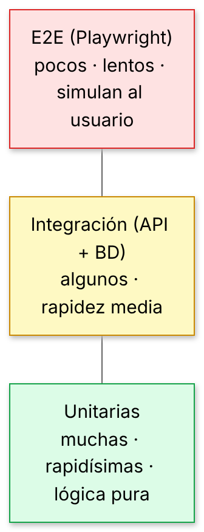{width=80%}

| Tipo | Qué prueba | Velocidad | Cuántos |
|---|---|---|---|
| **Unitarios** | Una función o módulo aislado (p. ej. el *hash* de contraseñas, un validador). | Milisegundos | Muchos |
| **Integración** | Varias piezas juntas: la **API con su base de datos** (peticiones HTTP reales). | Decenas de ms | Bastantes |
| **E2E** (*end-to-end*) | **El sistema completo** como un usuario: un navegador real hace clic y lee la pantalla. | Segundos | Pocos, de lo crítico |

**Objetivo:** **cubrir lo crítico, no el 100 %.** Un test que comprueba que el logo está en rojo cuesta más de lo que vale. Un test que comprueba que "un alumno no puede borrar la entrada de otro" vale oro.

## 1.3. ¿Qué probar? Los criterios de aceptación

¿Recuerdas los **criterios de aceptación** del Tema 1 (*Dado… cuando… entonces…*)? **Cada criterio se convierte en un test**. Es la forma más fácil de saber qué probar:

| Criterio de aceptación | Test en CampusBlog |
|---|---|
| Sin sesión no puedo crear una entrada | `crear una entrada sin token → 401 con Problem Details` |
| Datos inválidos → error por campo | `validación: datos incorrectos → 422 con lista de errores` |
| Un alumno no puede borrar lo de otro | `control de acceso: … → 403` |
| Solo el profesorado publica | `solo el profesorado publica` |
| El login no revela si el email existe | `login incorrecto → 401 sin revelar si existe el email` |

## 1.4. Tests unitarios

CampusBlog usa el ejecutor de tests **integrado en Node** (`node:test`), sin instalar nada. En empresas verás sobre todo **Vitest** o **Jest** (JavaScript/TypeScript), **JUnit** (Java), **PHPUnit/Pest** (PHP) o **pytest** (Python). La estructura es siempre la misma: *preparar → ejecutar → comprobar* (*Arrange – Act – Assert*).

```javascript
import { test } from 'node:test';
import assert from 'node:assert/strict';
import { hashPassword, verifyPassword } from '../src/auth.js';

test('hashPassword no guarda la contraseña en claro y verifica bien', () => {
  const h = hashPassword('clave-segura-1');            // Arrange + Act
  assert.ok(!h.includes('clave-segura-1'));            // Assert
  assert.equal(verifyPassword('clave-segura-1', h), true);
  assert.equal(verifyPassword('otra-clave', h), false);
});

test('dos hashes de la misma contraseña son distintos (sal aleatoria)', () => {
  assert.notEqual(hashPassword('abc12345'), hashPassword('abc12345'));
});
```

Fíjate en que los tests **documentan el comportamiento esperado**: el segundo nos recuerda por qué usamos *sal* aleatoria.

## 1.5. Tests de integración de la API

Aquí se arranca la aplicación **de verdad** (con una base de datos en memoria) y se le hacen peticiones HTTP reales. Es donde se encuentran la mayoría de errores útiles.

```javascript
before(async () => {
  const db = openDb(':memory:');                  // BD nueva y vacía en cada ejecución
  seed(db);                                       // datos de prueba
  server = createApp(db).listen(0);               // puerto aleatorio libre
  base = `http://localhost:${server.address().port}`;
});

test('control de acceso: un alumno no puede borrar la entrada de otro (403)', async () => {
  const luis = await login('luis@campus.test', 'clave-segura-2');
  const res = await call('/api/posts/1', { method: 'DELETE', token: luis });   // la entrada 1 es de Ana
  assert.equal(res.status, 403);
});
```

### Dobles de prueba: probar sin gastar dinero ni depender de internet

¿Cómo pruebas el resumen con IA (Tema 4) sin llamar de verdad a un servicio de pago? Con un **doble de prueba** (*mock/fake/stub*): un objeto falso con la misma forma que el real. CampusBlog **inyecta** el cliente en la función que crea las rutas, así que el test pasa uno falso:

```javascript
const fakeClient = {
  messages: {
    create: async (params) => {
      llamadas.push(params);                      // guardamos qué se le ha pedido
      return { stop_reason: 'end_turn', content: [{ type: 'text', text: 'Resumen de prueba.' }],
               usage: { input_tokens: 80, output_tokens: 5 } };
    },
  },
};
server = createApp(db, { aiClient: fakeClient }).listen(0);
```

::: {.consejo custom-style="Consejo"}
**Consejo.** Diseñar el código para poder **inyectar dependencias** (recibir la base de datos o el cliente externo como parámetro en vez de crearlos dentro) es lo que hace que algo sea **fácil de probar**. Es una de las ideas de diseño más valoradas en las empresas.
:::

## 1.6. Resultado y cobertura

Así se ejecuta toda la batería de CampusBlog (resultado real):

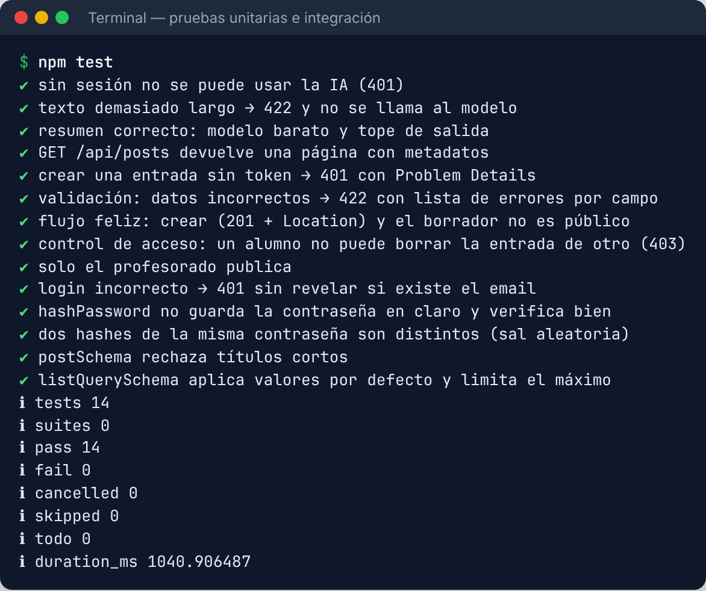{width=90%}

La **cobertura** (*coverage*) mide qué porcentaje del código se ejecuta al lanzar los tests. Node la incluye de serie:

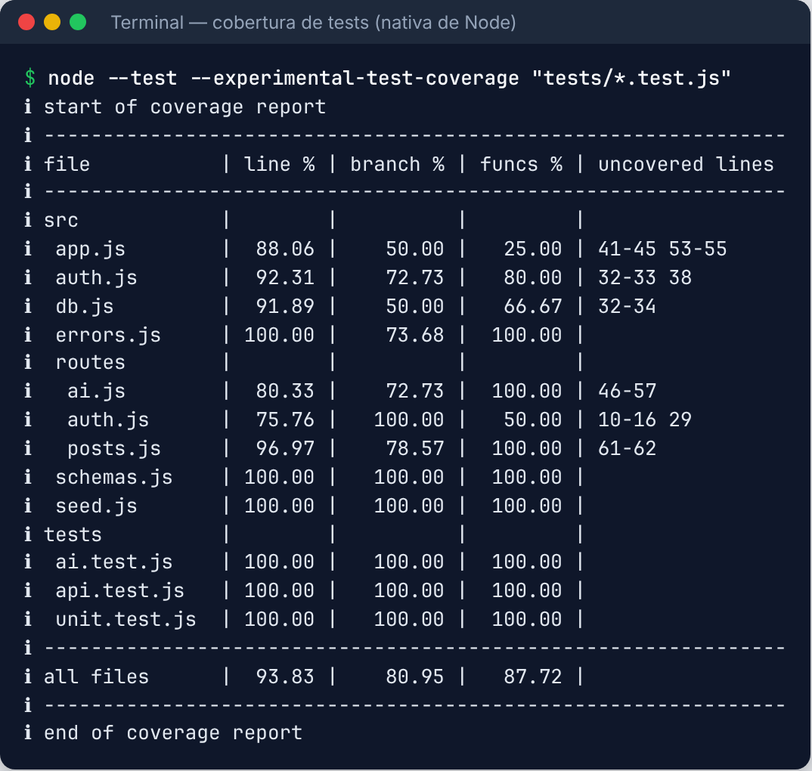{width=85%}

Lo valioso no es el porcentaje (93,8 %) sino la **columna "uncovered lines"**: te dice **exactamente qué falta por probar**. Por ejemplo, el registro de usuarios (`routes/auth.js`, líneas 10–16) no tiene test propio: es un buen candidato.

::: {.aviso custom-style="Aviso"}
**Aviso.** **Cobertura alta ≠ tests buenos.** Se puede ejecutar una línea sin comprobar nada. Una buena prueba tiene **aserciones significativas**; y una buena forma de comprobarlo es *romper el código a propósito* y ver si algún test falla.
:::

## 1.7. Tests E2E con Playwright

Los tests E2E controlan un **navegador real** (Chromium, Firefox, WebKit) y hacen lo que haría un usuario. **Playwright** es hoy la herramienta de referencia (compite con **Cypress** y el veterano **Selenium**, que seguirás viendo en muchas empresas). Un test es muy legible:

```javascript
import { test, expect } from '@playwright/test';

test('el buscador filtra por título', async ({ page }) => {
  await page.goto('/');
  await page.getByLabel('Buscar entradas por título').fill('Express');
  await page.getByRole('button', { name: 'Buscar' }).click();
  await expect(page.getByRole('heading', { level: 2 })).toHaveCount(1);
  await expect(page.getByRole('heading', { level: 2 })).toContainText('Express');
});
```

Fíjate en cómo **localiza** los elementos: `getByLabel`, `getByRole`, `getByText`. Es decir, **como los ve un usuario** (o un lector de pantalla), no por clases CSS frágiles. **Escribir E2E obliga a que tu interfaz sea accesible**.

El archivo `playwright.config.js` define dos "proyectos" (escritorio y móvil) y arranca el servidor solo:

```javascript
export default defineConfig({
  testDir: './e2e',
  use: { baseURL: 'http://localhost:3100', trace: 'on-first-retry' },
  projects: [
    { name: 'escritorio', use: { ...devices['Desktop Chrome'] } },
    { name: 'movil', use: { ...devices['Pixel 7'] } },
  ],
  webServer: { command: 'SEED=1 PORT=3100 node src/server.js', url: 'http://localhost:3100/api/health' },
});
```

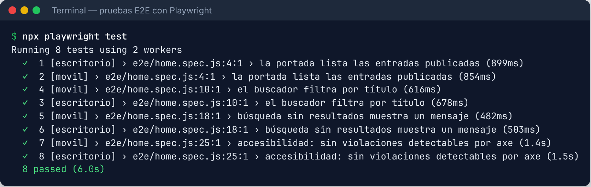{width=90%}

Playwright genera además un **informe HTML** con el detalle de cada prueba (y, si falla, un *trace* con capturas paso a paso que puedes reproducir como una película):

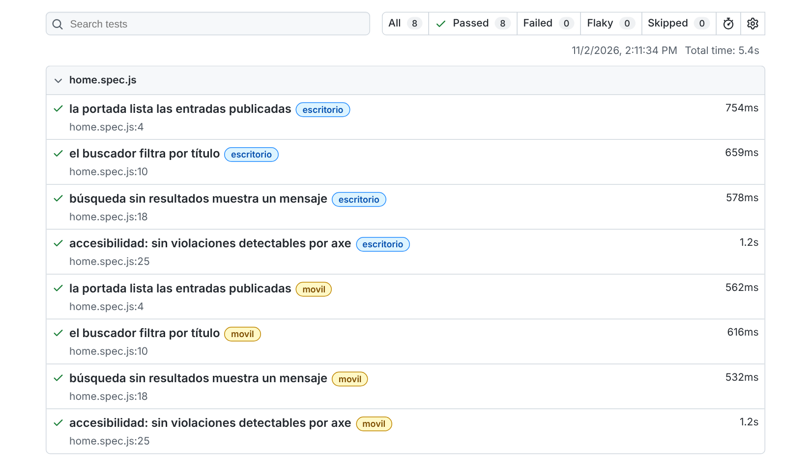{width=85%}

::: {.consejo custom-style="Consejo"}
**Consejo.** Playwright tiene un **generador de código**: `npx playwright codegen http://localhost:3000` abre un navegador y **escribe el test mientras navegas**. Úsalo para empezar y luego mejora los selectores. También tiene un **modo UI** (`npx playwright test --ui`) para depurar.
:::

::: {.empresa custom-style="En la empresa"}
**En la empresa.** Los tests se ejecutan **automáticamente en el CI** (GitHub Actions, GitLab CI, Jenkins…) en cada Pull Request; si fallan, no se puede fusionar. Verás también **SonarQube/SonarCloud** para medir calidad y cobertura, y **herramientas de QA** como TestRail o Jira Xray. En muchas empresas hay perfiles de **QA automation** que escriben justo este tipo de tests.
:::

Para sumar los E2E a vuestro CI (ampliación del Tema 1):

```yaml
      - run: npx playwright install --with-deps chromium
      - run: npx playwright test
      - uses: actions/upload-artifact@v4          # guarda el informe si falla
        if: failure()
        with: { name: playwright-report, path: playwright-report/ }
```

::: {.reto custom-style="Reto"}
**Reto 1 (2–3 h).** Para vuestro proyecto: (1) escribid **un test por cada criterio de aceptación *Must*** de vuestras historias; (2) incluid **al menos 3 de integración** (uno de ellos de **permisos**: 401 o 403) y **1 E2E** del flujo principal; (3) añadidlos al CI. **Criterio de éxito:** una PR con un test roto queda bloqueada; y **rompéis el código a propósito** para ver que algún test falla.
:::

# 2. Seguridad básica (OWASP Top 10)

La seguridad **no se añade al final**: se diseña desde el principio. **OWASP** (*Open Worldwide Application Security Project*) es una organización que publica el **Top 10** de los riesgos más críticos de las aplicaciones web (lo revisan cada pocos años; consulta siempre la edición vigente en owasp.org). Es **lectura obligada** y se cita en cualquier entrevista o auditoría.

## 2.1. El mapa de riesgos y las defensas de CampusBlog

| Riesgo (OWASP Top 10, ed. 2021) | En una frase | Defensa en CampusBlog |
|---|---|---|
| **A01** Control de acceso roto | Hacer cosas que no te corresponden (borrar lo de otro) | `if (post.author_id !== req.user.id && role !== 'admin') → 403` + test |
| **A02** Fallos criptográficos | Contraseñas o datos sensibles mal protegidos | `scrypt` con sal; HTTPS; secretos en variables de entorno |
| **A03** Inyección | Que el usuario "cuele" código en una consulta | Consultas **parametrizadas** y validación con zod |
| **A04** Diseño inseguro | Falta de seguridad desde el diseño | Roles definidos; borradores no públicos; límites de tamaño |
| **A05** Configuración incorrecta | Cabeceras ausentes, errores detallados | **Helmet** (cabeceras), CSP; errores 5xx genéricos |
| **A06** Componentes vulnerables | Librerías con fallos conocidos | `npm audit`, Dependabot |
| **A07** Fallos de autenticación | Fuerza bruta, sesiones débiles | *Rate limit* en `/auth`, mensaje idéntico para email o clave erróneos |
| **A08** Integridad de software y datos | Dependencias o CI manipulados | `package-lock.json`, `npm ci`, revisar PRs |
| **A09** Fallos de registro y monitorización | No te enteras de que te atacan | Registro de errores 5xx en el servidor |
| **A10** SSRF | Que tu servidor haga peticiones a donde no debe | No se hacen peticiones con URLs del usuario |

Vamos a ver las defensas más importantes **con código real**.

## 2.2. Contraseñas: nunca en claro, siempre con *hash* y sal

Una base de datos **se acabará filtrando** algún día (a todas les pasa). Si guardas las contraseñas en claro, expones a tus usuarios en **todos los sitios donde reutilizan la clave**. La solución: guardar solo un **hash** (una huella irreversible) calculado con un algoritmo **lento a propósito** y con una **sal** (valor aleatorio distinto por usuario).

| Algoritmo | Estado |
|---|---|
| MD5, SHA-1, SHA-256 "a pelo" | ❌ **No sirven** para contraseñas (demasiado rápidos). |
| **bcrypt** | ✅ Clásico y muy extendido en empresas. |
| **scrypt** | ✅ Moderno; incluido en Node (`node:crypto`). Lo usa CampusBlog. |
| **Argon2id** | ✅ Recomendación actual de OWASP para proyectos nuevos. |

```javascript
import { scryptSync, randomBytes, timingSafeEqual } from 'node:crypto';

export function hashPassword(plain) {
  const salt = randomBytes(16);                                   // sal distinta cada vez
  return `${salt.toString('hex')}:${scryptSync(plain, salt, 64).toString('hex')}`;
}

export function verifyPassword(plain, stored) {
  const [salt, hash] = stored.split(':');
  const candidate = scryptSync(plain, Buffer.from(salt, 'hex'), 64);
  return timingSafeEqual(candidate, Buffer.from(hash, 'hex'));   // comparación en tiempo constante
}
```

::: {.aviso custom-style="Aviso"}
**Aviso.** **Nunca inventes tu propia criptografía.** Usa las librerías estándar. Y **nunca** registres contraseñas en los *logs*, ni las devuelvas en una respuesta de la API (ni siquiera el hash).
:::

Detalle sutil de CampusBlog: el login devuelve **el mismo mensaje** si el email no existe o si la clave es errónea (`Credenciales incorrectas`). Así no revelas **qué emails están registrados**. Hay un test que lo comprueba.

## 2.3. Sesiones, JWT y OAuth ("Login con Google")

**Autenticación** = ¿quién eres? **Autorización** = ¿qué puedes hacer? Hay dos enfoques principales para recordar al usuario entre peticiones:

| | **Sesión con cookie** | **JWT** (*JSON Web Token*) |
|---|---|---|
| Qué se guarda | El servidor guarda la sesión; el navegador, un identificador en una cookie. | El token (firmado) lleva los datos; el servidor no guarda nada. |
| Revocar | ✅ Fácil (borras la sesión). | ❌ Difícil hasta que caduque. |
| Ideal para | Apps web clásicas (Laravel, Spring MVC, Django…). | APIs, móviles y SPAs separadas del servidor. |
| Riesgo típico | CSRF (si la cookie no está bien configurada). | Robo del token (XSS) si se guarda en `localStorage`. |

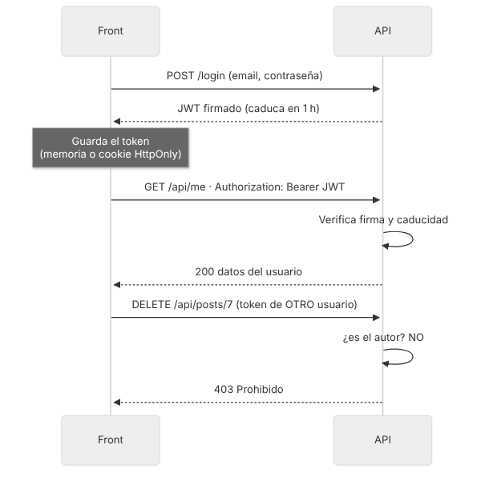{width=75%}

Un JWT son **tres partes** en Base64: cabecera, contenido (*payload*) y firma. **El contenido NO está cifrado**, solo firmado: cualquiera puede leerlo; nadie puede **modificarlo** sin invalidar la firma.

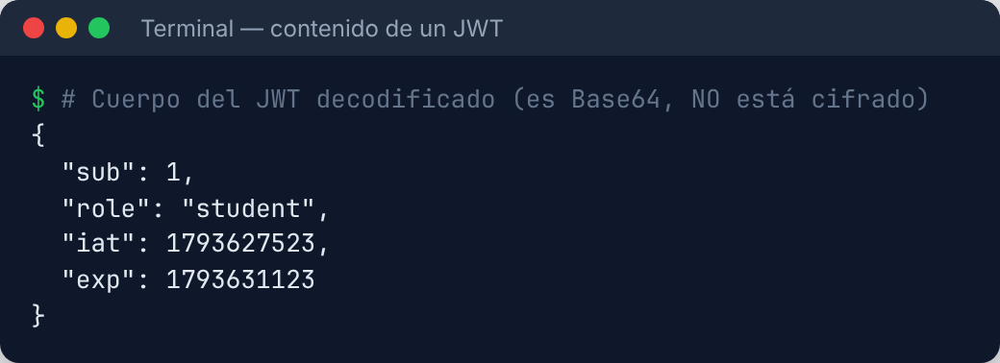{width=60%}

```javascript
export const signToken = (user) =>
  jwt.sign({ sub: user.id, role: user.role }, SECRET, { expiresIn: '1h' });   // caduca en 1 hora

export function requireAuth(req, _res, next) {
  const header = req.headers.authorization ?? '';
  if (!header.startsWith('Bearer ')) return next(unauthorized());
  try {
    const payload = jwt.verify(header.slice(7), SECRET);       // comprueba firma Y caducidad
    req.user = { id: payload.sub, role: payload.role };
    next();
  } catch { next(unauthorized('Token no válido o caducado')); }
}
```

**Buenas prácticas con JWT:** caducidad **corta**; secreto **largo y aleatorio** en una variable de entorno (nunca en el código); si el front guarda el token, mejor en una **cookie `HttpOnly; Secure; SameSite`** que en `localStorage` (así un XSS no lo puede leer); y **comprueba el rol en el servidor** (el front puede ocultar un botón, pero **cualquiera puede llamar a la API a mano**).

### OAuth 2.0 / OpenID Connect: "Iniciar sesión con Google"

En vez de gestionar tú las contraseñas, **delegas** la autenticación en un proveedor (Google, GitHub, Microsoft…) mediante **OAuth 2.0 + OpenID Connect**. Ventajas: **menos riesgo** (no guardas contraseñas), mejor experiencia y registro más rápido. Flujo simplificado (*Authorization Code*, el recomendado, con **PKCE** en apps públicas):

1. El usuario pulsa **"Entrar con Google"** y tu app lo **redirige** a Google.
2. Google le pide que se identifique y **consienta** compartir su email/nombre.
3. Google **redirige de vuelta** a tu app con un **código** temporal.
4. Tu **servidor** cambia ese código por **tokens** (con su `client_secret`, que **nunca** va al navegador).
5. Lees el **perfil** (email, nombre) y creas tu propia sesión.

Para configurarlo creas credenciales **OAuth** en la consola del proveedor (en Google: *Google Cloud Console → APIs y servicios → Credenciales*) y registras la **URL de redirección** de tu app. Casi nunca implementarás el protocolo a mano; se usan librerías:

| Stack | Librería habitual |
|---|---|
| Node/Express | **Passport.js** (estrategias `passport-google-oauth20`…) |
| Next.js | **Auth.js** (antes NextAuth) |
| Laravel | **Socialite** |
| Spring Boot | **Spring Security OAuth2 Client** |
| Servicios gestionados | **Auth0**, **Firebase Authentication**, **Clerk**, **Supabase Auth**, **Keycloak** (autoalojado) |

::: {.empresa custom-style="En la empresa"}
**En la empresa.** En entornos corporativos el inicio de sesión suele ser **SSO** (*Single Sign-On*) con **OpenID Connect o SAML** contra **Microsoft Entra ID (Azure AD)**, **Okta** o **Keycloak**. Entender OAuth/OIDC es una de las competencias más valoradas.
:::

## 2.4. Control de acceso, validación y límites

**A01 (control de acceso roto)** es hoy el riesgo nº 1. La regla es: **toda petición se autoriza en el servidor, recurso por recurso**. No basta con comprobar que estás logueado; hay que comprobar que **ese recurso es tuyo**:

```javascript
r.delete('/:id', requireAuth, (req, res) => {
  const post = db.prepare('SELECT author_id FROM posts WHERE id = ?').get(req.params.id);
  if (!post) throw notFound('La entrada');
  // Control de acceso a nivel de objeto: solo el autor o un admin
  if (post.author_id !== req.user.id && req.user.role !== 'admin') throw forbidden();
  db.prepare('DELETE FROM posts WHERE id = ?').run(req.params.id);
  res.status(204).end();
});
```

Y para frenar la **fuerza bruta** (probar miles de contraseñas), un **límite de peticiones** (*rate limiting*) en las rutas de autenticación:

```javascript
app.use('/api/auth', rateLimit({ windowMs: 15 * 60_000, limit: 20, standardHeaders: true }));
```

## 2.5. Inyección SQL: el clásico que sigue funcionando

Ocurre cuando **concatenas** lo que escribe el usuario dentro de una consulta SQL. El usuario puede escribir **SQL en lugar de datos**. Demostración **didáctica** (base de datos de juguete en memoria; ejecutada de verdad):

```javascript
// ❌ VULNERABLE: la entrada del usuario se pega dentro de la consulta
const mala = `SELECT email FROM users WHERE email = '${entrada}'`;

// ✅ SEGURO: consulta parametrizada; la entrada viaja aparte, como dato
db.prepare('SELECT email FROM users WHERE email = ?').all(entrada);
```

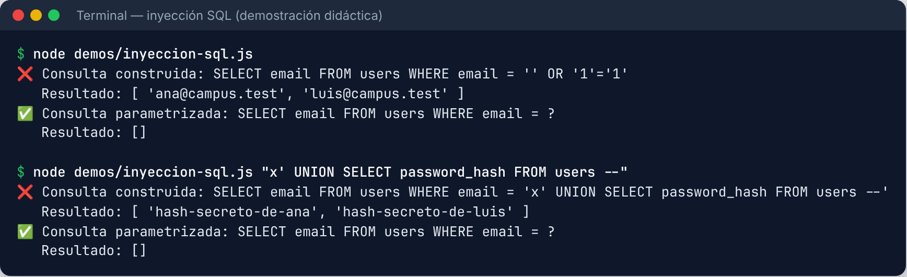{width=95%}

**La defensa es sencilla y absoluta: consultas parametrizadas (`?`/`:nombre`) siempre**, o un ORM que las use por ti. **Nunca** concatenes ni interpoles texto del usuario en SQL.

## 2.6. XSS: cuando tu web ejecuta el código de otro

El **XSS** (*Cross-Site Scripting*) ocurre si tu página inserta como **HTML** texto escrito por un usuario. Si alguien publica una entrada con título `` y tú lo pintas con `innerHTML`, ese código se ejecuta **en el navegador de todos los lectores**.

```javascript
// ❌ Peligroso con datos de usuarios
li.innerHTML = `<h2>${p.title}</h2>`;

// ✅ Seguro: el navegador trata el valor como TEXTO
const h2 = document.createElement('h2');
h2.textContent = p.title;
```

Defensas en capas:

1. **Escapar siempre al pintar** (`textContent`; los frameworks modernos como React, Vue o Angular **escapan por defecto**; el peligro está en `dangerouslySetInnerHTML`, `v-html`, `[innerHTML]` o `|raw`).
2. Si **debes** permitir HTML (editor de texto enriquecido), **sanéalo** con una librería como **DOMPurify**.
3. Una **Content Security Policy (CSP)**: una cabecera que dice al navegador *qué scripts puede ejecutar*. CampusBlog la configura con **Helmet** (una librería de Express que añade cabeceras de seguridad de golpe):

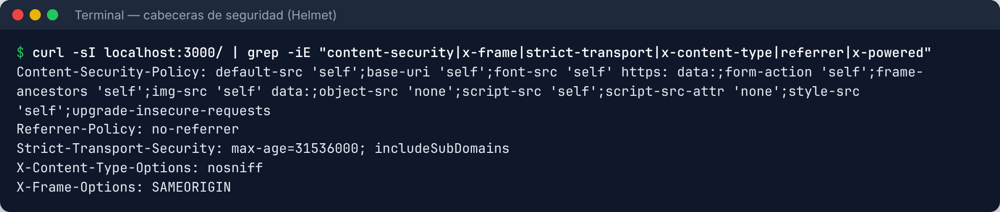{width=95%}

Observa `script-src 'self'`: el navegador **solo ejecutará scripts de nuestro propio dominio**; un `<script>` inyectado no correría. Y no aparece `X-Powered-By: Express`: **no cuentes al atacante qué tecnología usas**.

## 2.7. CSRF y CORS: dos siglas que se confunden

**CSRF** (*Cross-Site Request Forgery*): una web maliciosa hace que **tu navegador** envíe, **con tus cookies**, una petición a otra web donde estás logueado (por ejemplo, "transferir dinero"). Solo afecta cuando la autenticación se envía **automáticamente** (cookies). Defensas: cookies con **`SameSite=Lax` o `Strict`**, **tokens anti-CSRF** (los frameworks como Laravel, Django o Spring Security los traen), y comprobar el origen. Una API con **JWT en cabecera `Authorization`** (que el navegador no envía solo) no es vulnerable a CSRF clásico.

**CORS** (*Cross-Origin Resource Sharing*) **no es una defensa tuya contra atacantes**: es una **restricción del navegador** que impide que una web de un origen lea respuestas de otro origen, salvo que el servidor lo permita. Si tu front está en `http://localhost:5173` y tu API en `http://localhost:3000`, el navegador bloqueará las peticiones **a menos que la API lo autorice**:

```javascript
// ✅ Permite SOLO el origen de tu front
app.use(cors({ origin: process.env.CORS_ORIGIN ?? 'http://localhost:3000' }));

// ❌ Evita en producción: permite a cualquier web usar tu API desde el navegador de tus usuarios
app.use(cors({ origin: '*' }));
```

::: {.aviso custom-style="Aviso"}
**Aviso.** Si ves "*blocked by CORS policy*" **no desactives la seguridad del navegador**: configura el servidor para permitir **el origen concreto** de tu front. Y recuerda: CORS **no** protege la API de `curl` ni de otros servidores; para eso están la autenticación y la autorización.
:::

## 2.8. Gestión de secretos: `.env`, nunca en Git

Un **secreto** es cualquier cosa que da acceso: claves de API, contraseñas de la BD, el secreto del JWT, tokens. La regla de oro: **los secretos no viajan en el repositorio**.

1. Van en **variables de entorno**, en un archivo `.env` **local** que está en `.gitignore`.
2. Se sube **solo un `.env.example`** con los **nombres** y valores falsos, para que tu pareja sepa qué debe rellenar.
3. En producción se configuran en el panel del proveedor (Render, Railway, Vercel, GitHub Actions *Secrets*…).
4. **El código falla si falta el secreto** (mejor que arrancar con uno por defecto en producción).

```bash
# .env.example  (SÍ se sube a Git)
JWT_SECRET=cambia-esto-por-un-valor-largo-y-aleatorio
CORS_ORIGIN=http://localhost:3000

# .gitignore  (el .env REAL no se sube nunca)
.env
.env.local
```

```javascript
export const SECRET = process.env.JWT_SECRET
  ?? (process.env.NODE_ENV === 'production' ? undefined : 'solo-para-desarrollo');
if (!SECRET) throw new Error('Falta la variable de entorno JWT_SECRET');   // en producción, sin secreto no arranca
```

::: {.aviso custom-style="Aviso"}
**Aviso. ¿Has subido una clave a GitHub por error?** Borrar el commit **NO basta**: los bots rastrean GitHub y la encuentran en **segundos**, y sigue en el historial. Procedimiento: **1)** **revoca/rota la clave inmediatamente** (genera una nueva en el panel del proveedor); **2)** actualiza el sitio donde se usa; **3)** después, limpia el historial si procede. **Rotar es lo primero y lo único imprescindible.**
:::

Herramientas que vigilan esto por ti: **GitHub *secret scanning* y *push protection*** (bloquea el *push* si detecta una clave), **gitleaks** y **git-secrets** (en un *hook* local o en el CI).

## 2.9. Dependencias vulnerables

Tu proyecto incluye **cientos de librerías** de terceros (las tuyas y las de las que dependen). Cuando se descubre un fallo en una, **tu aplicación lo hereda**. `npm audit` consulta una base de datos de vulnerabilidades conocidas. Resultado **real** sobre CampusBlog (a fecha de 2 de noviembre de 2026):

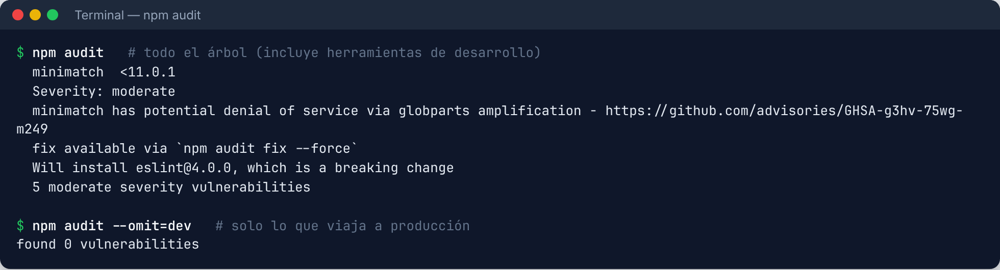{width=90%}

**¿Qué hacemos?** Aprende a **triar**, no a asustarte:

1. **Lee el aviso.** Aquí, todo viene de `minimatch` a través de **ESLint**, que es una **herramienta de desarrollo** (no se despliega).
2. **Comprueba lo que llega a producción:** `npm audit --omit=dev` → **0 vulnerabilidades**. El riesgo real es bajo.
3. **No ejecutes `npm audit fix --force` a ciegas.** Fíjate en lo que propone: *"Will install eslint@4.0.0"*, ¡**una versión antigua** y con cambios incompatibles! Sería **peor** que el problema.
4. Actualiza las dependencias de forma **controlada** y **vuelve a pasar los tests**. Activa **Dependabot** (GitHub) o **Renovate**: abren PRs automáticas cuando hay versiones nuevas o avisos de seguridad.

::: {.empresa custom-style="En la empresa"}
**En la empresa.** Esto se llama **gestión de la cadena de suministro de software** (*software supply chain*) y **SCA** (*Software Composition Analysis*). Herramientas habituales: **Dependabot**, **Renovate**, **Snyk**, **Trivy**, **OWASP Dependency-Check**. Se exige cada vez más un **SBOM** (lista de componentes del software).
:::

::: {.reto custom-style="Reto"}
**Reto 2 (2 h).** Auditad vuestro proyecto: (1) comprobad que **ninguna contraseña** se guarda en claro; (2) revisad **todas** las rutas protegidas: ¿comprueban **el dueño del recurso**? Escribid un test de **403** por cada una; (3) `grep` de `innerHTML`, `v-html`, `dangerouslySetInnerHTML`; (4) ejecutad `npm audit` y haced la **triaje**; (5) comprobad que no hay **ningún secreto** en el historial (`git log -p | grep -i secret`, o gitleaks). **Criterio de éxito:** un informe de una página con lo encontrado y lo arreglado.
:::

# 3. Accesibilidad y rendimiento

## 3.1. Por qué importa

Aproximadamente **una de cada seis personas** convive con alguna discapacidad, y todos tenemos limitaciones temporales o situacionales (un brazo escayolado, sol directo en la pantalla, un móvil en el autobús). Además, en España y la UE la accesibilidad es **un requisito legal** en el sector público y, con la **Ley Europea de Accesibilidad**, cada vez más en el privado. Y mejora el **SEO** y la **usabilidad de todos**.

## 3.2. WCAG: los cuatro principios (POUR)

Las **WCAG** (*Web Content Accessibility Guidelines*, del W3C) se organizan en cuatro principios. Una web debe ser:

| Principio | Significa | Ejemplos |
|---|---|---|
| **P**erceptible | Se puede **percibir** con los sentidos disponibles | Texto alternativo en imágenes, contraste suficiente, subtítulos |
| **O**perable | Se puede **manejar** con distintos dispositivos | Todo usable con **teclado**, sin trampas de foco, tiempo suficiente |
| **U**nderstandable (comprensible) | Se **entiende** | Idioma declarado, etiquetas claras, errores explicados |
| **R**obusto | Funciona con **tecnologías de apoyo** | HTML semántico válido, roles ARIA correctos |

Hay tres niveles de conformidad: **A**, **AA** y **AAA**. El objetivo habitual (y el exigido legalmente) es **AA**.

## 3.3. Los 10 arreglos que dan el 80 % del resultado

1. `<html lang="es">`: declara el idioma.
2. **Texto alternativo** (`alt`) en toda imagen informativa (`alt=""` si es decorativa).
3. **Contraste** del texto de al menos **4,5:1** (3:1 para texto grande).
4. Todo campo de formulario con su `<label>` asociado.
5. Botones y enlaces con **nombre accesible** (un icono solo necesita `aria-label`).
6. **Orden y jerarquía de títulos** correctos (un único `h1`, luego `h2`, `h3`…).
7. **Navegación completa con teclado** y **foco visible**.
8. **Landmarks** semánticos: `<header>`, `<nav>`, `<main>`, `<footer>`.
9. Un enlace **"Saltar al contenido"** al principio.
10. Mensajes de error **claros** y asociados al campo, y avisos dinámicos con `aria-live`.

## 3.4. Medir con axe

**axe-core** (de Deque) es el motor de pruebas de accesibilidad más usado; está dentro de Lighthouse, de la extensión **axe DevTools** y se integra en Playwright (`@axe-core/playwright`). Mira lo que detecta, **de verdad**, en esta página con problemas (imagen sin `alt`, texto casi invisible, campo sin etiqueta…):

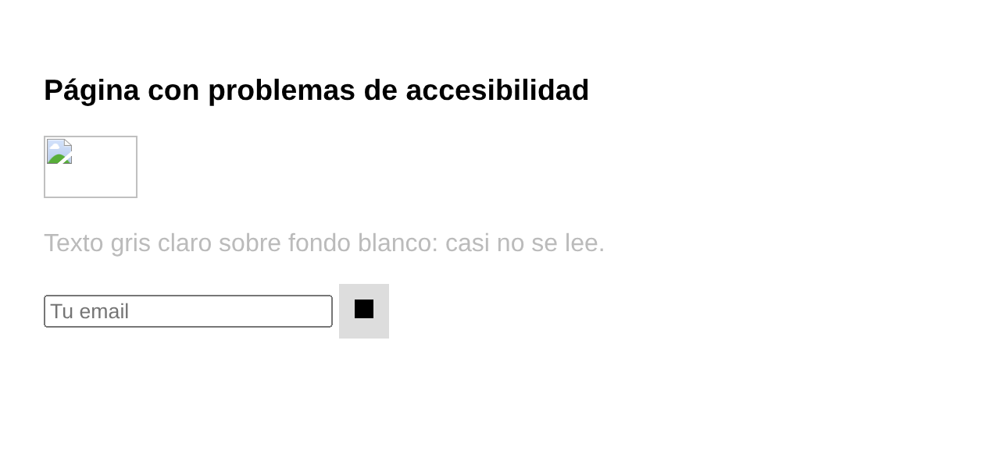{width=55%}

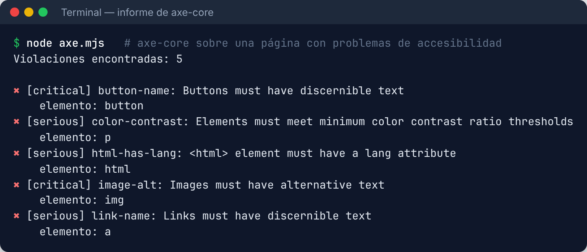{width=85%}

Y así se integra en un test E2E de CampusBlog (que **pasa sin violaciones** en escritorio y móvil):

```javascript
import AxeBuilder from '@axe-core/playwright';

test('accesibilidad: sin violaciones detectables por axe', async ({ page }) => {
  await page.goto('/');
  await expect(page.getByRole('heading', { level: 2 }).first()).toBeVisible();
  const { violations } = await new AxeBuilder({ page }).withTags(['wcag2a', 'wcag2aa']).analyze();
  expect(violations).toEqual([]);
});
```

::: {.aviso custom-style="Aviso"}
**Aviso.** Las herramientas automáticas **solo detectan una parte de los problemas** (los que se pueden comprobar con reglas: contraste, etiquetas, atributos…). **No pueden juzgar** si un texto alternativo es útil, si el orden de lectura tiene sentido o si un flujo es cómodo. Complétalas **navegando solo con el teclado** y probando con un **lector de pantalla** (NVDA en Windows, VoiceOver en Mac/iOS, TalkBack en Android).
:::

## 3.5. Rendimiento: Lighthouse y Core Web Vitals

**Lighthouse** (incluido en Chrome DevTools) audita **rendimiento, accesibilidad, buenas prácticas y SEO** y da una nota de 0 a 100. Mide las **Core Web Vitals**, tres métricas con las que Google evalúa la experiencia real de usuario:

| Métrica | Mide | Bueno |
|---|---|---|
| **LCP** (*Largest Contentful Paint*) | Cuánto tarda en verse lo principal | ≤ 2,5 s |
| **INP** (*Interaction to Next Paint*) | Lo rápido que responde a clics y toques | ≤ 200 ms |
| **CLS** (*Cumulative Layout Shift*) | Cuánto "saltan" los elementos al cargar | ≤ 0,1 |

**Caso real con CampusBlog.** Primera auditoría (móvil simulado):

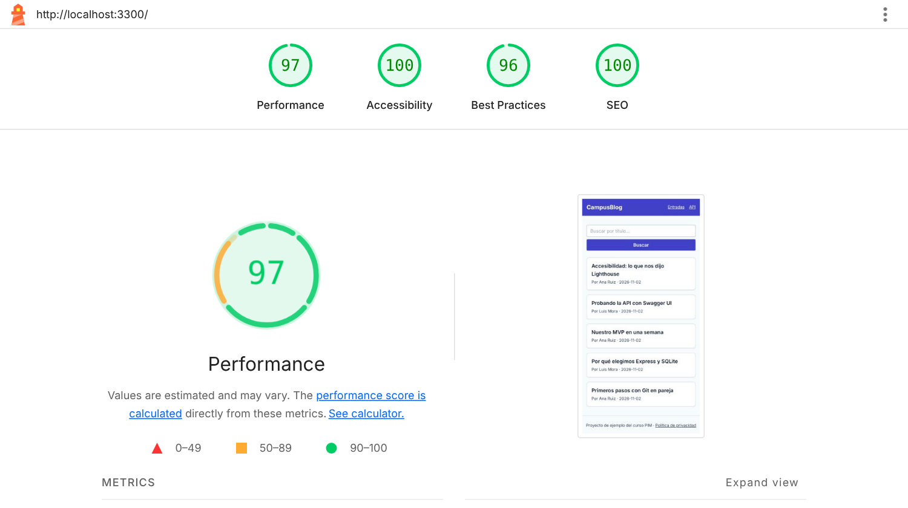{width=80%}

Lighthouse señaló dos problemas concretos: **CLS = 0,102** (justo por encima del 0,1 recomendado: el pie de página "saltaba" cuando la lista de entradas se cargaba por JavaScript) y un **error de consola** (la petición del *favicon*, que no existía). Los arreglos fueron **dos líneas**:

```html
<link rel="icon" href="data:," />                                    <!-- evita la petición 404 del favicon -->
<ul id="lista" class="grid min-h-[28rem] content-start gap-4 sm:grid-cols-2">  <!-- reserva espacio: sin saltos -->
```

Resultado tras el arreglo: **CLS = 0,014** y todas las categorías en 100:

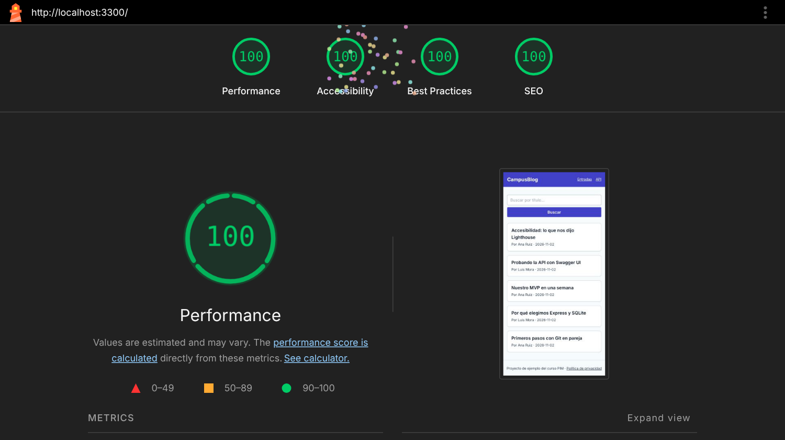{width=80%}

**Lecciones:** (1) **reserva el espacio** de lo que se carga después (imágenes con `width/height`, contenedores con altura mínima); (2) lo que se mide se puede mejorar; (3) los arreglos suelen ser pequeños. Otras medidas que casi siempre ayudan: imágenes en **WebP/AVIF** y con `loading="lazy"`, **minificar** CSS/JS, **cachear**, y cargar solo el JavaScript que hace falta.

::: {.consejo custom-style="Consejo"}
**Consejo.** Lighthouse se ejecuta también desde la **línea de comandos** y en el **CI** (por ejemplo, con *Lighthouse CI*) para que el rendimiento **no empeore sin que nadie lo note**. Establece un presupuesto: "la accesibilidad nunca baja de 95".
:::

::: {.reto custom-style="Reto"}
**Reto 3 (90 min).** (1) Pasad **Lighthouse** a vuestras dos pantallas principales y apuntad las notas. (2) Ejecutad **axe** (extensión o con Playwright) y arreglad **todas** las violaciones. (3) Navegad **solo con teclado** (Tab/Shift+Tab/Enter/Esc): ¿llegáis a todo? ¿se ve el foco? (4) Mejorad **una métrica** y **volved a medir**. **Criterio de éxito:** una tabla "antes/después" con lo arreglado.
:::

# 4. RGPD y LOPDGDD aplicados a tu proyecto

::: {.aviso custom-style="Aviso"}
**Aviso.** Este apartado es **formativo**, no asesoramiento jurídico. Para un proyecto real con datos de personas hay que consultar a un profesional y a la **AEPD** (Agencia Española de Protección de Datos, aepd.es), que publica guías y herramientas gratuitas (por ejemplo, **Facilita**, para pymes).
:::

## 4.1. Conceptos clave

El **RGPD** (Reglamento General de Protección de Datos, UE) y la **LOPDGDD** (Ley Orgánica 3/2018, que lo complementa en España) regulan el **tratamiento de datos personales**: cualquier dato que identifique o pueda identificar a una persona (nombre, email, IP, identificador de cookie…). **Si tu aplicación tiene usuarios registrados, trata datos personales y la ley te afecta.**

| Concepto | Qué es | En CampusBlog |
|---|---|---|
| **Responsable** | Quien decide para qué y cómo se tratan los datos | Ana y Luis (proyecto formativo) |
| **Interesado** | La persona cuyos datos se tratan | El usuario registrado |
| **Finalidad** | Para qué se usan | Identificarte y atribuirte tus entradas |
| **Base legitimadora** | Por qué es lícito (consentimiento, contrato, obligación legal, interés legítimo…) | Ejecución del servicio que solicita el usuario |

## 4.2. Principios que se aplican directamente al código

1. **Minimización:** pide **solo lo imprescindible**. ¿Necesitas la fecha de nacimiento, el teléfono, la dirección? Si no, **no lo pidas** (los datos que no tienes no se pueden filtrar). CampusBlog solo guarda **email, nombre y hash de contraseña**.
2. **Limitación de la finalidad:** no uses los datos para otra cosa distinta de la que anunciaste.
3. **Limitación del plazo de conservación:** no los guardes **eternamente**; define cuánto y bórralos.
4. **Integridad y confidencialidad:** protégelos (todo lo que has visto en el apartado de seguridad: *hash*, HTTPS, control de acceso).
5. **Transparencia:** informa de forma **clara y accesible** (política de privacidad).
6. **Privacidad desde el diseño y por defecto:** el diseño ya incluye la protección; la opción por defecto es la **menos intrusiva**.

## 4.3. Los derechos de las personas

Tu aplicación debe permitir ejercer estos derechos (en un plazo máximo de **un mes**):

| Derecho | Qué permite | Cómo implementarlo |
|---|---|---|
| **Acceso** | Saber qué datos tienes de la persona | Un botón "Descargar mis datos" (JSON) |
| **Rectificación** | Corregirlos | Editar perfil |
| **Supresión** ("derecho al olvido") | Que los borres | **Un botón "Eliminar mi cuenta"** que borre (o anonimice) los datos |
| **Oposición / Limitación** | Que dejes de tratarlos o los restrinjas | Opciones de privacidad |
| **Portabilidad** | Llevárselos en formato legible por máquina | La misma exportación JSON |

En CampusBlog, la tabla `posts` tiene `author_id … ON DELETE CASCADE`: **al borrar un usuario se borran sus entradas**. Es una decisión de diseño que debe **estar pensada** (¿se borran, o se anonimizan para no perder el contenido?).

## 4.4. La política de privacidad

Es un texto **claro y fácil de encontrar** (enlace en el pie de **todas** las páginas) que explica: **quién** es el responsable y cómo contactarlo, **qué datos** se recogen, **para qué**, **base legal**, **cuánto tiempo** se conservan, **con quién** se comparten y **cómo ejercer los derechos**. Esta es la de CampusBlog (versión formativa, mínima):

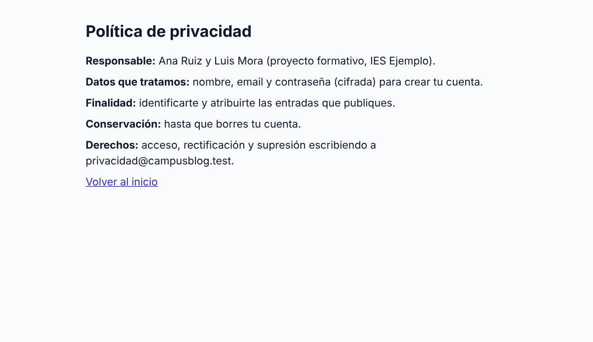{width=75%}

## 4.5. Cookies

En España y la UE, las cookies están reguladas por la **LSSI** (art. 22.2) junto con el RGPD y **la guía de la AEPD**. Resumen práctico:

| Tipo | Ejemplos | ¿Consentimiento? |
|---|---|---|
| **Técnicas / necesarias** | Sesión, carrito, preferencias de idioma que tú pides | **No** (pero hay que informar) |
| **Analítica** | Google Analytics, Matomo | **Sí**, previo |
| **Publicidad / seguimiento** | Redes publicitarias, píxeles | **Sí**, previo |

Si tu proyecto **solo usa cookies técnicas** (como CampusBlog) **no necesitas banner de consentimiento**, pero sí **informar** en la política. En cuanto añadas **analítica o terceros** (Google Analytics, vídeos embebidos de YouTube con cookies, mapas…), sí necesitas pedir consentimiento **antes** de cargarlos. Reglas de un banner correcto:

- Los botones **"Aceptar" y "Rechazar" con el mismo nivel de visibilidad**.
- **Nada no necesario se carga antes** de que el usuario acepte.
- Permitir **configurar por categorías** y **cambiar la decisión** después.
- Enlace a la **política de cookies**.

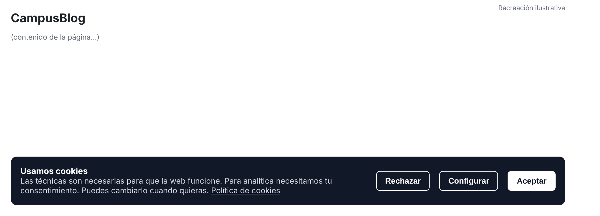{width=85%}

::: {.consejo custom-style="Consejo"}
**Consejo.** La forma más fácil de cumplir: **evita las cookies de seguimiento**. Alternativas de analítica respetuosa con la privacidad, sin cookies: **Plausible**, **Umami** o **Matomo** configurado sin cookies. Menos burocracia y mejor experiencia.
:::

::: {.empresa custom-style="En la empresa"}
**En la empresa.** Hay un **DPO / Delegado de Protección de Datos** en muchas organizaciones; los desarrolladores deben conocer los **Registros de Actividades de Tratamiento**, las **evaluaciones de impacto (EIPD)**, los **encargados del tratamiento** (si usas un proveedor como Firebase o AWS, firmas un contrato con él) y el procedimiento de **brechas de seguridad** (hay que notificar a la AEPD **en 72 horas**). Conocer esto te distingue en las prácticas.
:::

::: {.reto custom-style="Reto"}
**Reto 4 (90 min).** (1) Haced un **inventario de datos personales** de vuestro proyecto: qué campos, para qué sirve cada uno y si **de verdad** hace falta. Eliminad lo que sobre. (2) Redactad la **política de privacidad** con las 7 secciones del apartado 4.4. (3) Implementad (o diseñad) **"Descargar mis datos"** y **"Eliminar mi cuenta"**. (4) Listad vuestras **cookies** y decidid si necesitáis consentimiento. **Criterio de éxito:** podéis explicar, para cada dato, la finalidad y cuándo se borra.
:::

# 5. Linters, formateadores y *pre-commit hooks*

La calidad no debería depender de **acordarse** de ejecutar cosas. Las herramientas de este apartado **lo hacen automáticamente**, y eliminan discusiones tontas ("¿tabuladores o espacios?") de los *code reviews*.

| Herramienta | Qué hace |
|---|---|
| **EditorConfig** (`.editorconfig`) | Sangría, fin de línea y codificación coherentes en cualquier editor. |
| **Prettier** | **Formatea** el código automáticamente (un único estilo para todos). |
| **ESLint** | **Analiza** el código y avisa de errores y malas prácticas (variables sin usar, etc.). |
| **Husky** | Gestiona los *Git hooks* (scripts que Git ejecuta en ciertos momentos). |
| **lint-staged** | Ejecuta ESLint/Prettier **solo sobre los archivos del commit**. |
| **commitlint** | Comprueba que el mensaje cumple *Conventional Commits* (Tema 1). |

Configuración real de CampusBlog (ESLint "flat config" y Prettier):

```javascript
// eslint.config.js
import js from '@eslint/js';
import globals from 'globals';

export default [
  { ignores: ['node_modules/', 'playwright-report/', 'public/styles.css'] },
  js.configs.recommended,
  {
    languageOptions: { globals: { ...globals.node, ...globals.browser } },
    rules: { 'no-unused-vars': ['error', { argsIgnorePattern: '^_' }] },
  },
];
```

```json
// .prettierrc.json
{ "singleQuote": true, "printWidth": 110 }
```

```json
// package.json (fragmento)
"scripts": { "lint": "eslint .", "format": "prettier --write ." },
"lint-staged": { "*.js": ["eslint --fix", "prettier --write"] }
```

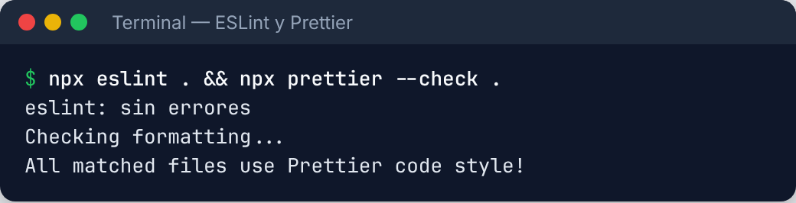{width=75%}

## 5.1. Pre-commit hooks con Husky y lint-staged

Un ***pre-commit hook*** es un script que se ejecuta **justo antes de cada commit** y puede **abortarlo**. Se configura así:

```bash
npm i -D husky lint-staged
npx husky init
echo "npx lint-staged" > .husky/pre-commit      # lo que se ejecuta antes de cada commit
```

Veamos qué ocurre **de verdad** (salida real de un repositorio de prueba). Primero, un archivo **mal formateado**: lint-staged lo **arregla solo** antes del commit.

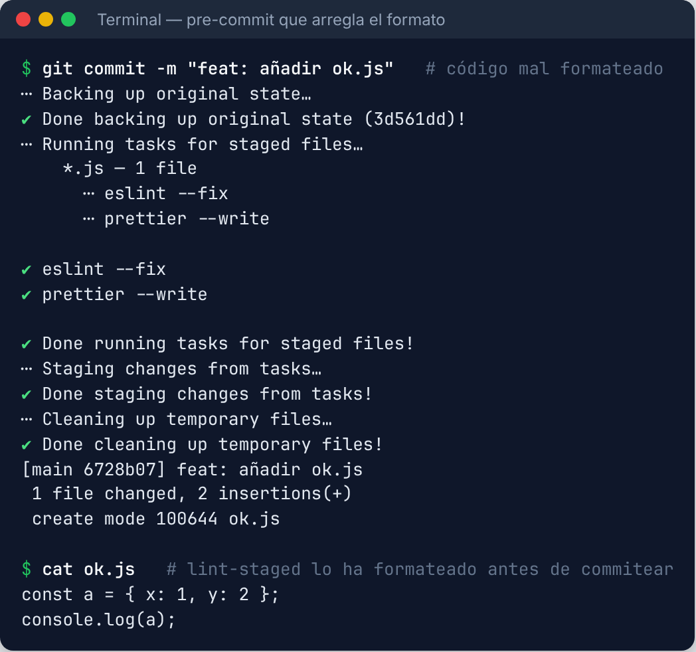{width=85%}

Y ahora uno con un **error de lint** (una variable declarada y no usada): **el commit se bloquea**.

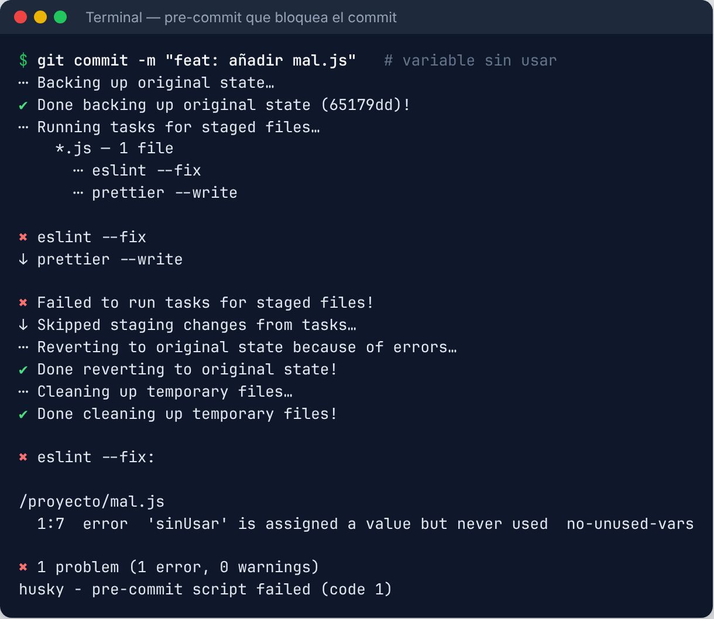{width=85%}

::: {.aviso custom-style="Aviso"}
**Aviso.** Los *hooks* locales **se pueden saltar** (`git commit --no-verify`). Por eso **no sustituyen** al CI ni a la protección de `main` (Tema 1): son la **primera línea** (rápida y local); el CI es la **definitiva** (obligatoria para todos).
:::

La cadena de calidad completa queda así:

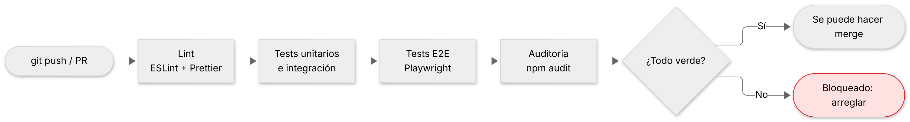{width=90%}

::: {.reto custom-style="Reto"}
**Reto 5 (60 min).** (1) Añadid **ESLint y Prettier** a vuestro proyecto y corregid los avisos. (2) Configurad **Husky + lint-staged** y comprobad que bloquea un commit con un error de lint. (3) Completad el **CI** con lint, tests, E2E y `npm audit --omit=dev`. **Criterio de éxito:** un commit con código mal formateado se arregla solo y uno con un error de lint **no** entra.
:::

# Resumen del tema

- **Tests:** pirámide (muchos unitarios, algunos de integración, pocos E2E); cada **criterio de aceptación** es un test; **dobles de prueba** para lo externo; la **cobertura** señala lo que falta, pero no mide la calidad. **Playwright** para E2E.
- **Seguridad (OWASP):** **hash lento con sal** (scrypt/bcrypt/Argon2), **JWT** de vida corta o sesiones con cookie `HttpOnly`, **OAuth/OIDC** para "Login con Google"; **autorizar en el servidor, recurso a recurso**; **consultas parametrizadas**; **escapar la salida** y **CSP** contra XSS; **SameSite/tokens** contra CSRF; **CORS** con origen concreto; **secretos fuera de Git** (y **rotar** si se filtran); **triar** `npm audit`.
- **Accesibilidad y rendimiento:** **WCAG AA** (POUR), **axe** + teclado + lector de pantalla; **Lighthouse** y **Core Web Vitals** (LCP, INP, CLS); lo que se mide, se mejora.
- **RGPD/LOPDGDD:** **minimización**, finalidad, conservación, **política de privacidad**, **derechos** (acceso, supresión…), **cookies** (técnicas sin banner; analítica con consentimiento previo).
- **Automatización:** **ESLint + Prettier + EditorConfig**, **hooks** con **Husky + lint-staged**, y el **CI** como control definitivo.

## Glosario

| Término | Significado |
|---|---|
| **Test unitario / integración / E2E** | Prueba de una pieza / de varias juntas / del sistema completo como un usuario. |
| **Doble de prueba (mock)** | Objeto falso que sustituye a una dependencia real en un test. |
| **Cobertura** | Porcentaje de código ejecutado por los tests. |
| **OWASP Top 10** | Lista de los 10 riesgos de seguridad web más críticos. |
| **Hash / sal** | Huella irreversible de una contraseña / valor aleatorio que se añade antes. |
| **JWT** | Token firmado que lleva datos del usuario. |
| **OAuth 2.0 / OIDC** | Protocolos para delegar la autenticación en un proveedor. |
| **Inyección SQL** | Colar SQL a través de una entrada concatenada en una consulta. |
| **XSS** | Ejecutar script de un atacante en el navegador de otros usuarios. |
| **CSRF** | Hacer que el navegador de la víctima envíe una petición no deseada. |
| **CORS** | Política del navegador sobre qué orígenes pueden leer respuestas de tu API. |
| **CSP** | Cabecera que restringe qué recursos y scripts puede cargar la página. |
| **WCAG** | Pautas internacionales de accesibilidad web (niveles A/AA/AAA). |
| **Core Web Vitals** | LCP, INP y CLS: métricas de experiencia de usuario. |
| **RGPD / LOPDGDD** | Normativa europea y española de protección de datos. |
| **Pre-commit hook** | Script que se ejecuta antes de un commit y puede abortarlo. |

## Recursos para seguir

- *OWASP* — owasp.org/Top10 y la *Cheat Sheet Series* (cheatsheetseries.owasp.org), en especial "Password Storage" y "Authentication".
- *Playwright* — playwright.dev · *Vitest* — vitest.dev · *Testing Library* — testing-library.com.
- *W3C WAI* — w3.org/WAI · *WCAG en español* (traducciones del W3C) · *axe DevTools* · *web.dev* (Lighthouse, Core Web Vitals).
- *AEPD* — aepd.es (Guía de cookies, herramienta **Facilita**, guías para desarrolladores).
- *ESLint* — eslint.org · *Prettier* — prettier.io · *Husky* — typicode.github.io/husky.
- *PortSwigger Web Security Academy* — portswigger.net/web-security (laboratorios gratuitos y **legales** para practicar).

# Autoevaluación

Contesta sin mirar los apartados. En el **paquete SCORM (Moodle)** las preguntas son interactivas y dan nota; aquí tienes las mismas con **solución razonada al final**. Aprobado: **70 %**.
